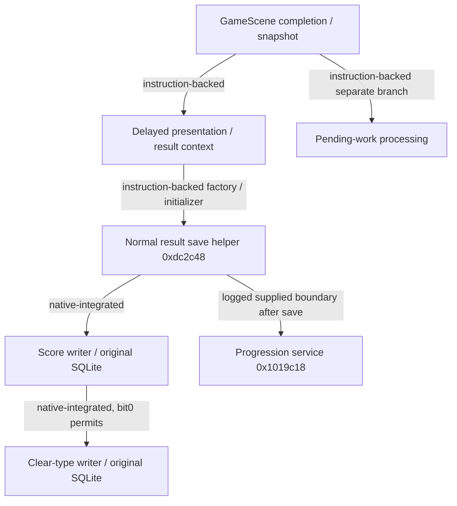

# Expedition 013 — Result Persistence, Local Records & Submission Eligibility

Date: 2026-10-24. Project Arconist; `thgillwtnorizoh/arconist`, `main`.

## Result

**Strong success, with a small bounded pending-work extension.** Original ARM64 result-screen save helpers, score writer, clear-type writer, comparison/normalization routines, and the **bundled SQLite engine** execute against a private `:memory:` database. Original SQL preparation, binding, stepping, replacement and subsequent queries produce observable records. Host SQLite does not implement the database operations, and host code does not implement either save decision.

A native two-tap gameplay run produces PURE2, FAR0, final/recorded LOST0/0, score **10,000,002**, integer health80 and category3. Its cached GameResult passes through the complete ordinary save helper `0xdc2c48`, original writers and native SQLite. A repeated save preserves the exact row; original cached-record lookup also returns the generated result.

This is not a complete executed gameplay-completion-to-rendered-results-screen transition. The completion/delayed presentation/factory/UI initializer relationships are instruction-backed; the driver supplies the results context and invokes its original save helper. The surrounding ordinary eligibility block is separately executed with controlled state. Database file opening, on-disk durability, account startup, actual scene presentation and external submission remain outside coverage. No real application database or account records are accessed.

## What I Found

### Preparation, identity and evidence labels

Read the project instructions, inspected the supplied archive, read current context and complete012 report, studied006's result/persistence sections and consulted008–010's gameplay, snapshot and initialization evidence. Starting `main` is **`1633ca2a46b2c02b34ea8c947d8b95230a4a1980`**, tree `718672e2b9cabec5f3f9ebc816bddb06802a5bb7`; no013 report existed. Locally available loader/fixture files were inspected and reused. New persistence adapters and experiments were created during013; inaccessible prior Work memory is not claimed as recovered evidence.

The archive's `lib/arm64-v8a/libcocos2dcpp.so` has SHA-256 **`3eaca4e6dabb3395f276f8915698d57675757d0df0970e716b23a3dc201c79be`**, Build ID **`17d660edbf37ca78beefc32e07672c97419ddce6`**. All addresses below are main-library ELF virtual addresses before relocation. Original PT_LOAD segments and RELATIVE relocations are loaded in Unicorn ARM64. These experiments execute original instructions, not translated implementations of the writers.

- **Native-integrated:** original routines execute together on the explicitly described path, with declared environment services.
- **Native-isolated:** original routine/block executes with surrounding objects or callers supplied.
- **Instruction-backed:** decoded instructions, relocations, RTTI or archived code; enclosing path not completely executed.
- **Interpretation:** explanatory meaning supported by evidence.
- **Unknown:** unverified producer, reachability or effect.

Descriptive names are research labels unless identified as native RTTI names. Prior006 discoveries are independently verified below; they are not treated as new execution merely by citation. Two refinements are recorded here without editing006: writer `w2` is tested by **bit0**, and SQLite `ct` is the predicate **raw partition ==1**, not an unrestricted integer partition.

## Result-to-save call chain

### Completion, result ownership and presentation

**Instruction-backed production path:**

1. Ordinary GameScene completion `0xc27d34` sets scene+49a, records completion time, obtains model at scene+3e0 and ScoreState at model+38. It invokes snapshot `0x1600bb0` at `0xc27dcc` and retrieves the result from **ScoreState+68**. Snapshot's X0 return is not its reliable retrieval contract. The snapshot caches its result and later calls reuse it.
2. Completion retains a result/history entry, calls `0x1246c98` at `0xc27e8c` for separate pending-work processing, invokes other result/progression services, offers the special scene virtual+510 a completion override, and otherwise calls delayed presentation `0xe5c700` at `0xc27f1c`. A failure flag/category can alter the delay; this is not the SQLite writer.
3. `0xe5c700` installs the native `GameScene::songFinishedDelayUpdate` closure (RTTI at vtable `0x1b65058`). Its invocation `0x19bbdd0`, subsequent outro closure `0x147dee8`, callback `0xf0b48c` and scene-change closure `0x18f11c0` lead to result presentation. These scheduled closures are decoded, not replayed as an entire UI sequence here.
4. `0x18f11c0`'s ordinary branch retrieves model→ScoreState+68 (`0x18f1268–0x18f1274`), constructs a retained result context and stores the result at **context+18** (`0x18f1338–0x18f1340`). Context+20 comes from **special-scene+2b8**, or zero with no special scene (`0x18f1368–0x18f1378`). It is not established as the runtime gauge ID.
5. Result-scene selection `0xd11738` chooses among native result scenes. Constructor `0x187c0c8` installs the `NormalGameResultScene` vtable through GOT `0x1b96690`, stores/retains context at **scene+2e8** (`0x187c14c–0x187c154`), and initializes scene+2f8 to0. Other factory branches include World/Link Play/special result presentations. Full selection/account/UI initialization is not executed.
6. NormalGameResultScene initializer `0x891150`, identified by its vtable slot `0x1afe778` and RTTI `0x1afe298`, calls save helper **`0xdc2c48` at `0x8921b8`**, subject to the exact gate described below. This closes a concrete production call relationship; it does not assert execution of the entire initializer.



For the joined regression, the snapshot→result-context handoff is **driver-supplied** between original native calls. All calls from helper→writers→SQLite are original direct native calls after PLT resolution. No claim of an executed animation, platform queue or whole scene transition follows.

### Caller-specific save eligibility

**Ordinary initializer gate, `0x89219c–0x8921dc`:** load context+18 result; OR result byte+b0 with scene byte+2f8. If either is nonzero, bypass `0xdc2c48` and the adjacent `0x1049858` result/progression call. Result+b0 is the previously recovered expanded-cap flag, copied by snapshot from ScoreState+d0; the complete production policy for all its writers and scene+2f8 is not established. Do not reduce this gate to a generic account/login or failure test.

**Complete ordinary save helper `0xdc2c48`:** classify context+18 through `0x12a5574`. Read context+20 (special-scene integer described above). Set writer `w2=1` only when that integer is **8 or19** and classification is **not2 or3**; otherwise `w2=0`. The writer is invoked at **`0xdc2cd4`**, including classification0 when the outer gate allows it. After the local call, a nonzero category invokes `0x1019c18` with song, normalized difficulty and grade conversion `0xcad0fc`; category0 skips that later call. This subsequent service is logged/supplied in the executed fixtures. It is not evidence of successful network submission.

**Other independently executed helpers:**

| Helper | Production caller / identity | Observed saving policy |
|---|---|---|
| `0xe44c5c` | `0xb67bdc` within initializer `0xb6669c`, native RTTI **LinkPlayGameResultScene** | Writer `w2=0`, before category0 check; classifications0..5 all save score and attempt clear progression. |
| `0xc0c7a8` | `0xc93de0` within initializer `0xc93604`, native RTTI **CourseGameResultScene** | If song+bc is nonzero, catalog lookup `0x14ac9c4` and predicate `0x17c45f4` must pass. When allowed, score writer always runs; clear processing only for categories2/3 (`w2=0`), others `w2=1`. |
| `0xdc2c48` | `0x8921b8` in NormalGameResultScene; another call at `0x1a5381c` in its Designant request closure | Local write and clear suppression depend on the outer gate and context+20, not a universal completion/failure rule. The Designant closure is instruction-backed only. |

RTTI identifies the scene class, not an executed real multiplayer/course/network session. The prepared category combinations exercise native helpers with supplied scene context. In particular, first records with category0 and H−1 are successfully stored in both Link Play and ordinary mode0-context tests. **A failed result is not universally ineligible.** Early quit/retry is not automatically equivalent to this completed/snapshotted result path; all early-termination callers are unresolved.

## Local best-score persistence

### Original database and SQL path

`0x13552d4(databaseWrapper,result,w2)` executes original lazy-initialization check `0xeaa120`. The fixture supplies an already-open private database handle at wrapper+0 and sets **wrapper+100=1**; this intentionally bypasses application resource-path opening, not the writer's decision logic. Wrapper+108 is the native cached-result pointer vector, initially empty.

Original `sqlite3_open` at **`0x1a165bc`** opens `:memory:`. Schema is built by original `sqlite3_exec` using the binary's own strings:

- Scores creation at **`0x53a12b`**: `id integer primary key autoincrement not null`, `version`, `score`, `shinyPerfectCount`, `perfectCount`, `nearCount`, `missCount`, `date`, `songId text`, `songDifficulty`, `modifier`, `health` (other fields `int`).
- Clear creation at **`0x54c01d`**: `id integer primary key autoincrement not null`, `songId text`, `songDifficulty int`, `clearType int`.
- Original migrations **`0x52f68f`** and **`0x572972`**: `ALTER TABLE scores ADD COLUMN ct int default 0;` and `ALTER TABLE cleartypes ADD COLUMN ct int default 0;`. Decoded migration `0x12c8cac` references these at `0x12c8cf4/0x12c8d18` and executes them through SQLite. The driver executes those exact strings directly; it does not execute the complete schema-version/transaction migration dispatcher.

No guessed extra column or uniqueness constraint is supplied. SQLite table names are case-insensitive; native selection uses `cleartypes`, insertion uses `clearTypes`.

**Executed native SQL entries:**

| Operation | Original entry | Writer-side callsites |
|---|---|---|
| `sqlite3_exec` | `0xd07d38` | Driver schema setup; original migration callsites decoded |
| `sqlite3_prepare` | `0xc74490` | score `0x13554e8/0x135580c`; clear `0x12a6054/0x12a6368` |
| `sqlite3_step` | `0xfb92d8` | score `0x135555c/0x135595c`; clear `0x12a60c0/0x12a6400` |
| `sqlite3_bind_int` | `0x10fe95c` | score binds `0x1355834–0x1355954`; clear `0x12a63d0–0x12a63f8` |
| `sqlite3_bind_text` | `0x1a0aa78` | score `0x13558e8`; clear `0x12a63b8` |
| `sqlite3_finalize` | `0x1337c5c` | score `0x1355a60/0x1355ac8`; clear `0x12a6654/0x12a6678` |
| `sqlite3_column_int` | `0xf5f3a4` | Native selection of old id/score/type |
| `sqlite3_prepare_v2` | `0x1778520` | Independent driver-invoked native readback queries |
| `sqlite3_column_int64/text` | `0xe5fefc / 0x17c912c` | Independent native readback |

PLT imports named `sqlite3_*` are resolved by the harness to their corresponding **same-library original export addresses**, preserving the original LR. This is linker/environment support; the SQLite parser, virtual machine, B-tree/page behavior and writer branches remain original ARM64. File durability and a production DB connection are not implied by a successful in-memory SQLite write.

### Selection, strict improvement and SQL effects

The original writer assembles, for the baseline result:

```sql
SELECT id, score FROM scores WHERE songId = "expedition013" AND songDifficulty = "2" AND ct = "0"
```

Song is result+38's 24-byte libc++ string. `0x14ac910` preserves difficulty0..4 and maps other unsigned inputs to1. **`ct = (result.i32[+58] == 1)`**, implemented by CMP/CSET, is used in selection and binding. Raw2 is not a third DB partition.

Native step accepts ROW100 or DONE101 in the selection branch (`0x1355560–0x1355568`). Missing id is represented internally by **−1**. Existing stored score is compared to **getter `0x1315038(result)`**; signed old≥new skips score DML. Missing row inserts; strict improvement replaces the existing id with `INSERT OR REPLACE`.

Actual baseline insert:

```sql
INSERT INTO scores (version, score,shinyPerfectCount, perfectCount, nearCount, missCount, date, songId, songDifficulty, modifier, health, ct) VALUES (?2, ?3, ?4, ?5, ?6, ?7, ?8, ?9, ?10, ?11, ?12, ?13)
```

Replacement additionally supplies `id` and `?1`; native id reuse was observed. The skipped insert parameter1 is intentional in this SQL, not filled by the harness.

| Parameter | Baseline actual bound value | Native source |
|---:|---|---|
| 2 | 700255 | result+c |
| 3 | 9000000 | native getter |
| 4 / 5 / 6 / 7 | 10 / 10 / 1 / 1 | result+14/+18/+1c/**+20** |
| 8 | 100 | low signed32 bits of result+30 |
| 9 | `expedition013` | result+38 string |
| 10 | 2 | normalized result+50 |
| 11 | 0 | `0x10d50b0` then `0xdc2dd0` |
| 12 | 80 | signed integer result+28 |
| 13 | 0 | result+58 ==1 |

Native cache append `0xb360f8` follows insertion; replacement uses cached-record lookup `0x1513c24` and retain/release/vector operations. That lookup selects song/difficulty plus **raw result+58 equality to current global selection**, read through GOT `0x1b96348` (target `0x1bee958`). This differs from SQLite's Boolean ct normalization. Arbitrary prepared partition combinations are storage-boundary tests, not proof of production cache coherence across inconsistent global/result selections.

The writer returns1 after successfully completing both changing and nonchanging paths. **Return1 does not mean a new best was written.** This distinction was observed for lower/equal scores. Error branches include nonzero prepare/finalize results and selection step outside100/101, leading to native error construction/unwinding. These errors were decoded but not deliberately injected; failure atomicity, retries and crash recovery are untested. The score DML step at `0x135595c` is not immediately checked before native cache work; do not infer complete I/O-success guarantees from that call alone.

## Clear-type comparison and progression

`0x12a5e60(db,songString,difficulty,newType,rawPartition)` selects `id, clearType` by the same song, normalized difficulty and **rawPartition==1** predicate. DONE/no-row produces id−1 and insertion. For existing rows, helper **`0x196b22c` normalizes stored categories0..5 and maps invalid values to−1**; comparator **`0xe3c054(new,old)`** decides replacement. The helper is not a numeric-max implementation.

Executed all **42 comparator pairs** (old−1..5, new0..5), independently confirming006:

| Stored old type | New types accepted |
|---:|---|
| missing / −1 | 0,1,2,3,4,5 |
| 0 | 1,2,3,4,5 |
| 4 | 1,2,3,5 |
| 1 | 2,3,5 |
| 5 | 2,3 |
| 2 | 3 |
| 3 | none |

The valid-category order can be represented **0 < 4 < 1 < 5 < 2 < 3**, an interpretation of the executed relation. No untested category name is needed to use the exact codes.

Actual native insert SQL:

```sql
INSERT INTO clearTypes (songId, songDifficulty, clearType, ct) VALUES (?2, ?3, ?4, ?5)
```

Baseline binds are `?2="expedition013", ?3=2, ?4=1, ?5=0`. Replacement additionally binds existing id as?1. Clear progression runs **after the score-improvement branch**, even when no score DML occurred, unless writer `w2 & 1` is set (`TBNZ w21,#0` at **`0x1355a7c`**). Tested0/2 permit it;1/3 suppress it. All four still allow the best-score decision. The normal production helpers inspected supply0/1; even2 is an isolated ABI boundary test, not a discovered production caller value.

## Save eligibility and field provenance

| Persistent field | Original producer / GameResult source | Writer consumer | Verification |
|---|---|---|---|
| Song ID | Snapshot `0x1600cf4` copies chart+10's song string; factory `0x180e994`, initializer `0xcab7fc` place it at result+38 | Selection SQL and bind9; clear bind2 | Native-generated regression, native writers/SQLite; source chart ID supplied |
| Difficulty | Snapshot `0x1600d0c` reads chart+18 metadata+124 → result+50 | `0x14ac910` normalization, score bind10/clear bind3 | Native regression and separate difficulty2/3 records; full metadata loading not rerun |
| Best score | ScoreState counters/calculations → snapshot stored+10; getter `0x1315038` may compute effective score or honor+b1 | Comparison and bind3 use getter | Native gameplay override byte0; isolated fixtures byte+b1=1 explicitly selects prepared stored score |
| Shining / PURE / FAR | Native judgment counters → result+14/+18/+1c | binds4/5/6 | Gameplay2/2/0; isolated10/10/1 |
| LOST | Snapshot selects final total−PURE−FAR unless ScoreState+d1; also preserves recorded misses at result+24 | **bind7 reads final LOST+20**, not+24 | Native complete run0/0; isolated final1/recorded99 stored missCount1 |
| Clear type | Original classifier `0x12a5574`, using final counters, health/mode/result flags | Separate clear writer/comparator | Native category3 and prepared categories0..5; eligibility is caller-specific |
| Modifier | Outer result mode+54 → `0x10d50b0` → `0xdc2dd0` | bind11 | Both original conversions executed for modes0..14; baseline/native score row0 |
| Integer health | Active gauge H enters `0xcab7fc`; **FCVTMS at0xcab830** stores floor(H) at+28 | bind12 reads that integer | Joined native gameplay liveH80.4000015258789 → result/store80; no writer-side new rounding |
| Date | Snapshot calls imported `time(&value)` at0x1600bf8, carries64-bit value to result+30 | **sqlite3_bind_int** reads low32 | Fixed supplied epoch1700000000 survives regression; isolated0x80000000 stored−2147483648 |
| Version | Snapshot/factory passes version argument into result+c | bind2 | Native regression observed1; prepared fixtures700255. Neither is asserted as recovered production build policy |
| `ct` | Snapshot `0x1600d08–0x1600d10` reads current global through GOT1b96348 → result+58, initializer stores at0xcab918 | Both writers select/bind `(raw==1)`; native cache uses full raw/global equality | Raw0/1/2 native tests. Exact user-facing meaning, full startup producer and all allowed global values **Unknown** |

The chart/song/difficulty and global selection inputs are supplied fixture metadata, not invented outputs of the result writer. Modifier is not synonymous with ct or runtime gauge ID. Executed normalization:

| Outer mode | After0x10d50b0 | Persisted modifier after0xdc2dd0 |
|---|---|---|
| 0,1,2,3,4 | respectively0,1,2,3,4 | respectively0,1,2,0,0 |
| 5,6,7,8 | respectively1,2,0,0 | respectively1,2,0,0 |
| 9,10,11,12,13 | 2 | 2 |
| 14 | 14 | 0 |

These are conversion tests, not proof that every prepared mode/result combination naturally reaches the ordinary save path.

## Controlled database test results

### Fixtures and score/clear independence

Prepared isolated GameResult fixture: allocation0x100, actual vtable `0x1b054c0`; fields as in the bind table; default difficulty2, raw partition0, mode0, date100, health80. Byte+b1=1 deliberately makes getter return the prepared score. Category2 sets finalLOST0;3 also sets FAR0;4 uses outer mode1;5 mode2;0 uses health−1. Every fixture's category is checked by original classifier before saving. These deliberately controlled combinations are **Native-isolated persistence inputs**, not claimed natural gameplay outcomes.

For each row below the complete original score writer and, when permitted, clear writer execute with the native SQLite backend; original prepare/bind/step operations are logged and independent native SQL queries read the rows back. No host branch chooses insert/update/reject.

| Sequence, same song/difficulty/ct unless noted | New score / category / date | Observed best score / retained date | Observed clear | Decision |
|---|---|---|---:|---|
| Empty DB | 9000000 /1/100 | 9000000 /100 | 1 | Insert id1 |
| Higher | 9100000 /1/101 | 9100000 /101 | 1 | Replace id1 |
| Lower, stronger classification | 8900000 /2/102 | **9100000 /101** | **2** | Skip score; promote clear |
| Equal, stronger classification | 9100000 /3/103 | **9100000 /101** | **3** | Skip score; promote clear |
| Higher, weaker classification | 9200000 /1/104 | **9200000 /104** | **3** | Replace score; reject clear downgrade |
| Difficulty3 | 9000000 /1/100 | Separate score row | Separate1 | Difficulty2 unchanged |
| Song `other` | 9000000 /1/100 | Separate score row | Separate1 | Original song unchanged |
| Raw partition1 | 9000000 /1/100 | Separate ct1 row | ct1=1 | ct0 remains9200000/type3 |
| Raw partition2 | 9300000 /1/100 | **ct0 becomes9300000** | ct0 remains3 | No ct2 row; ct1 unchanged |

Separate first-save fixtures `flag0..flag3`, each score9000000/category3, show clear rows only for **w2=0 and2**. All four have score rows, and all writer calls return1. Thus skipped clear processing, unchanged score and unchanged clear are distinct observations.

Direct native clear-writer database pairs independently exercised: missing→0 inserts0;0→4 becomes4;4→1 becomes1;1→5 becomes5;5→2 becomes2;2→3 becomes3;3→2 remains3;1→1 remains1;5→4 remains5. Full comparator matrix and actual database updates agree. These tests cover representative transitions without generating every classification through gameplay.

### Ordinary gates and other callers

Executed original ordinary initializer block `0x89219c` up to stop **`0x8921dc`**, with supplied X20=scene, X28=application-global pointer, X22=0. Original helper/writers/SQLite execute when allowed; the later `0x1049858` subsystem is a return-only boundary. This is a scoped native block, not the complete UI initializer. Each case uses a distinct song key, with native DB/cache state retained and services supplied without seeding a score; per-key native SQL readback is the assertion.

| Result+b0 | Scene+2f8 | Context+20 | Category | Observed writer calls / score rows / clear rows |
|---:|---:|---:|---:|---|
| 0 | 0 | 0 | 0 | 1 /1 / type0 |
| 0 | 0 | 0 | 1 | 1 /1 / type1 |
| 0 | 0 | 8 | 1 | 1 /1 / none |
| 0 | 0 | 8 | 2 | 1 /1 / type2 |
| 0 | 0 | 19 | 5 | 1 /1 / none |
| 0 | 0 | 19 | 3 | 1 /1 / type3 |
| 1 | 0 | 0 | 3 | **0 /0 /none** |
| 0 | 1 | 0 | 3 | **0 /0 /none** |

Complete Link Play, Course and ordinary save helpers execute for each prepared category0..5. Across **all three sets**, there are **18 score rows**, and **14 clear rows**: six Link Play, six ordinary, two Course (types2/3). Each successful category also reaches the logged progression-service boundary; failed category0 does not. These totals are validation counts, not a claimed production play history.

For the Course catalog branch, song+bc=1 and supplied lookup `0x14ac9c4` returning null let **original `0x17c45f4`** reject the missing song; no row is written. The nonzero/fully initialized catalog-success branch is not executed; song+bc=0 bypasses the lookup in the six-category Course tests. Account/entitlement policy inside all positive catalog cases remains unresolved.

## Native gameplay-to-persistence regression

The minimal fixture reuses verified native gameplay infrastructure rather than rebuilding Android/AFF startup. It supplies chart/header/timing-group/configuration shells: 120BPM, speed6, density1, count2, note times1000/1150, chart end1270, lanes1/2, ordinary gauge and controlled timeline anchor. Song string `expedition013game`, difficulty metadata+124=2 and current raw partition0 are supplied. No full AFF parse, JNI queue or lifecycle run is claimed for013.

Original timing/note routines `0xbe2b98`, `0xddd644`, `0x1902ffc`, depth evaluation `0xcf918c`, native index allocation/producer `0xfc0184–0xfc02a4`/`0x1576aa4`, ScoreState/gauge factory `0x14f0a94`, frame `0x10a7550`, projected input **`0xeec024`**, native judgments/recorders/gauge calculations execute. Camera setup supplies a1280×720 projection environment with stationary geometry. At E1000 and1150, first run the model frame, then projected Touch input at respectively(290,360)/(540,360), supplied input IDs1000/1001. At E1271, run completion frame, then driver-invoke original snapshot `0x1600bb0(scoreState,1)` and **read scoreState+68**. This preserves the prior fixture's authoritative GameTimeline clock; wall date is separately supplied by `time`.

The driver builds the ordinary result context pointing to that unchanged result and invokes complete `0xdc2c48` twice. Its classification, writer selection, SQL operations and clear comparator are original. No score/result field is rewritten to force the regression outcome.

| Observation | Native GameResult | Native writer binds / first native SQL readback | After equal repeat |
|---|---|---|---|
| Score getter / stored score | 10000002 /10000002, override+b1=0 | score10000002 | identical |
| Shining / PURE / FAR | 2 /2 /0 | shinyPerfectCount2 / perfectCount2 / nearCount0 | identical |
| Final / recorded LOST | 0 /0 | missCount0 (final) | identical |
| Live / integer health | 80.4000015258789 /80 | health80 | identical |
| Classification | 3 | clearTypes.clearType3 | 3 |
| Song / difficulty / partition | expedition013game /2 /0 | same song /2 /ct0 | identical |
| Version / date / modifier | 1 /1700000000 / normalized0 | version1 / date1700000000 / modifier0 | identical |
| Stored id | — | 1 | 1 |

Subsequent **original `0x1513c24`** cached-record query returns the exact generated GameResult pointer; independent original SQLite query returns the row shown. Regression counts include one snapshot, two score-writer calls, two clear-writer calls and one existing-type comparator call. Actual gameplay→result and save-helper→writers→SQLite are Native-integrated segments; their results-context/caller handoff is supplied. The enclosing completion/UI transition remains instruction-backed.

The baseline time adapter inherited from older fixtures did not write `time`'s output pointer, producing an invalid date during the first exploratory run. It was corrected to implement `time(&t)` with fixed1700000000; the final gameplay regression above was rerun and checked. An early conversion sweep also incorrectly asserted ordinary classification for all outer modes; the final sweep changes mode only for the isolated conversion call and makes no such classification assertion. Failed probes are not reported as passing validations.

## Pending work and submission boundary

**Instruction-backed:** completion's `0x1246c98` first requires scene+380 packet/context to exist and packet+88 to be zero. It enriches that object, retrieves the cached result, stores classification through `0x14bf9cc`, invokes `0x1568764`, and calls **`0xe26e44` at0x1246e08**, using the owner obtained from app+d8. It then calls `0x101e88c` and surrounding scheduling/services. This occurs on the completion path before delayed result presentation, whereas ordinary local saving occurs later in result initialization. Local saving and queueing are not the same operation.

**Native-isolated extension:** an initially empty queue owner (24-byte vector header at+30) and a prepared zeroed packet0x100 with byte+c=7 execute **entire `0xe26e44` → original serializer `0x18b6c78` → native vector growth `0xf5e508`**. Return1, queue entries0→1, payload length25, exact bytes **07 followed by24 zero bytes**. Only allocation/copy/free boundaries are hit. Packet+20/+28 event-record vector and its limit+38 are empty/zero; byte-vector fields+40 and+70 are empty. This is a deliberately minimal serializer/queue test, **not a normal completed gameplay packet** and not a GameResult pointer passed where another packet type is required.

`0xe26e44` has count/aggregate-byte bounds and returns0 on its rejection branch. `0x101e88c` inspects queue bounds and contains scheduler/service calls including Director+ a0 and `0x16db30c`; these consumers, retry behavior and transport are **not executed**. No precise external HTTP submission endpoint or acceptance boundary is established in013. Stop at the pending-work consumer/scheduling interface; do not rename a successful queue append “leaderboard submission.” The separate post-save `0x1019c18` service likewise is not executed beyond the logged boundary. No authentication or network transmission occurs.

## Recovered pseudocode

The following is instruction-backed control flow; comments distinguish the newly executed segments. Names for context fields are descriptive.

```python
# Production completion/presentation: decoded, not executed end-to-end in013.
def finish_scene(scene, failed):
    ss = scene.model.scoreState
    native_snapshot_1600bb0(ss, scene_snapshot_mode(scene))
    result = ss.cached68                 # do not rely on snapshot X0
    native_result_history_retain(result)
    process_pending_packet_1246c98(scene) # separate from SQLite local save
    if not special_scene_handles_finish(scene, failed):
        schedule_delayed_result_presentation(scene, failed)
        # decoded closures build retained context.result18 = result
        # context.special20 = specialScene.id2b8, or0
        # factory chooses result scene; Normal stores context at+2e8

# Original gate block executed with supplied surrounding initializer state.
def normal_result_init_save_block(scene):
    r = scene.context2e8.result18
    if r.expandedCapB0 or scene.gate2f8:
        return
    normal_save_dc2c48(scene)             # complete helper executed in013
    result_progression_1049858(...)       # supplied return-only in gate test

def normal_save_dc2c48(scene):
    r = scene.context2e8.result18
    clear = native_classify_12a5574(r)
    special = scene.context2e8.special20
    skip_clear = int(special in (8, 19) and clear not in (2, 3))
    save_score_13552d4(app.database30, r, skip_clear)
    if clear != 0:
        progression_1019c18(r.song, normalize_difficulty(r.difficulty),
                           native_grade_cad0fc(r))  # logged boundary

# Entire decision/SQL chain below executes original ARM64 + native SQLite.
def save_score_13552d4(db, r, flags):
    native_ensure_db_eaa120(db)           # already-open fixture ready100=1
    diff = normalize_14ac910(r.i50)
    ct = int(r.i58 == 1)
    old = native_sql_select_id_score(r.song38, diff, ct)
    if old.missing or native_score_1315038(r) > old.score:
        native_sql_insert_or_replace(
            id=old.id_if_present,
            version=r.i0c, score=native_score_1315038(r),
            shiny=r.i14, pure=r.i18, far=r.i1c, lost=r.i20,
            date=signed_low32(r.i64_30), song=r.song38, difficulty=diff,
            modifier=dc2dd0(10d50b0(r)), health=r.i28, ct=ct)
        native_update_cached_result_vector(db, r)
    if (flags & 1) == 0:
        save_clear_12a5e60(db, r.song38, r.i50,
                          native_classify_12a5574(r), r.i58)
    native_finalize_statements()
    return 1                             # unchanged record can also return1

def save_clear_12a5e60(db, song, raw_diff, new_type, raw_partition):
    diff = normalize_14ac910(raw_diff)
    ct = int(raw_partition == 1)
    old = native_sql_select_id_type(song, diff, ct)
    if old.missing or e3c054(new_type, normalize_196b22c(old.type)):
        native_sql_insert_or_replace_clear(old.id_if_present,
                                           song, diff, new_type, ct)
    native_finalize_statements()

# Native-isolated queue extension only; real packet production not joined.
def enqueue_e26e44(owner, packet):
    if native_queue_bounds_reject(owner): return 0
    payload = native_serialize_18b6c78(packet)
    owner.vector30.append_move(payload)   # original native vector operations
    return 1                             # no server acceptance implied
```

## Remaining synthetic dependencies

### Executed runtime-service inventory

No writer, classifier, comparator, difficulty/modifier normalizer, SQLite prepare/bind/step/column/finalize function, queue serializer or queue vector growth routine is replaced by host decision logic. The following **supplied services were actually hit** in the successful persistence/gameplay tests; standard-library functions have ordinary primitive semantics, not chart/save rules.

| Boundary | Addresses / supplied behavior |
|---|---|
| Memory allocation/reallocation/reclamation | operator new `0x1a6d9c0`, malloc `0x1a6df10`, realloc `0x1a6df00`; zero-initialized aligned bump arena; allocation sizes are tracked for the available `malloc_usable_size` adapter (not hit in the final listed traces). Free/delete `0x1a6ded0/0x1a6d9e0`, array new/delete `0x1a6e090/0x1a6e0a0` do not establish real reclamation. |
| Memory/character primitives | memcpy `0x1a6d9d0`, memmove `0x1a6daf0`, memset `0x1a6db30`, memcmp `0x1a6da80`, strlen `0x1a6dad0`, strcmp `0x1a6e100`, checked strlen `0x1a6dc50`. |
| libc++ string primitives | copy/assign `0x1a6da50/0x1a6db80`, append `0x1a6db00/0x1a6db20`, integer conversion `0x1a6db60`, insert `0x1a6dc00`, prefix concatenation `0x1a6dc10`; actual short/long 24-byte layout is maintained. |
| Single-threaded synchronization | pthread mutex attributes/init/destroy/lock/unlock `0x1a6e690/6a0/6b0/6c0/6d0/6e0/700`, return success. Stable thread identity supplied where needed. No concurrency/locking correctness claim. |
| Clock/process/entropy | monotonic clock `0x1a6dc60` follows controlled gameplay milliseconds; `time` `0x1a6de50` writes/returns1700000000; getpid `0x1a6e520` returns1; `open` `0x1a6e720` permits only an attempted `/dev/urandom`, returns−1; `__errno` `0x1a6e540` supplies2. Native SQLite's fallback entropy path executes. No DB file is opened. gettimeofday adapter exists but was not hit in final recorded test traces. |
| Ref/object infrastructure | `0x121a0ec`, `0x10ac6e8`, `0x147fe48`, `0xd6dc98` supplied Ref/init/autorelease/retain/release behavior; actual reference destruction is not established. |
| Gameplay-only shell | prepared Director getter `0xa4227c`, RTTI adapter `0x1a6db90` matching the fixture's native hierarchy; optional visual/provider/delegate boundaries `0xbda064`, `0x107af5c`, `0x19f2e40`, `0xe2388c`, delegate target `0x4000200` return without external effects. Native judgment/result logic remains original. |
| Result-scene services | app/global objects, result context and private DB wrapper supplied. `0x1019c18` logs song/difficulty/grade and returns; gate test `0x1049858` returns; Course rejection test `0x14ac9c4` supplies missing catalog entry. Positive catalog predicate/account services are unexecuted. |
| SQLite binding | unresolved same-library sqlite3 PLT entries jump to original exports. External Android/ELF loader execution is not claimed. Unused API/global-symbol paths, e.g. version-string lookup, are not validated by these writer tests. |

The arena occupies controlled mapped memory and does not emulate a production allocator, filesystem journal, crash recovery, account store or Android process. No actual database file, real score submission, audio output or GPU work is required. Temporary harnesses, databases and traces remain research intermediates and are not authorized publication contents.

### Updated integration coverage

| Path |013 evidence | Boundary |
|---|---|---|
| Gameplay judgment → score/gauge → cached GameResult | Native-integrated, two-tap regression | prepared chart/config/Touch/camera and controlled clocks; snapshot driver-invoked |
| GameScene finish → delayed closures → result-scene selection | Instruction-backed | complete UI/animation/factory startup unexecuted |
| Ordinary initializer save gate | Native-isolated original block, calls integrated helper/writers | surrounding initializer state supplied |
| Normal/Link Play/Course save helpers → native writers | Native-integrated scoped | prepared result/context; progression service logged |
| Best-score/clear decisions → SQLite effects/readback | **Native-integrated with original SQLite backend** | in-memory DB, schema setup scheduled by driver, runtime adapters |
| Cached-record lookup of generated result | Native-integrated | raw selection0 agrees with fixture global0 |
| Pending-work serialize → queue append | Native-isolated enclosing entry; integrated serializer/vector routines | minimal prepared packet, not full gameplay packet |
| Queue consumer → transport/server acceptance | Unknown / decoded scheduling interface only | not executed; no transmission |
| On-disk persistence, migration rollback, restart reload | Unknown | private in-memory DB only |

## Unresolved Mysteries

1. Exact user-facing meaning and complete production initialization/writers of global `0x1bee958` / result+58 / ct; Boolean SQL partitioning and raw cache selection are established without naming them account type, chart type or network mode.
2. Every production writer and reachability condition of result+b0, scene+2f8 and special-scene IDs8/19. The transferred integer comes from special-scene+2b8; it is not proven identical to outer gauge mode. Positive Course catalog/entitlement cases remain bounded.
3. Full completion→animation→results-scene construction/init execution, all failure/early-quit/retry routes and special presentations. A prepared completed result reaching a real helper does not execute every UI eligibility producer.
4. Actual on-disk path/provider startup, schema-version orchestration/rollback, file durability/reload, I/O errors, concurrent writes and native cache behavior for inconsistent raw/global selections. No memory-leak or persistence-loss conclusion follows from the supplied allocator or unexecuted error paths.
5. Fully populated pending packet fields, queue flushing/retry ownership, result serialization across all modes and external network/account submission policy. Queue membership, local best, stored clear and server acceptance remain four separate states.
6. Remaining optional ability/result modifiers and unusual flag combinations. Prepared stored-score/category combinations are deliberately isolated tests, not a demonstration of naturally achievable scores. Flick remains gameplay-unproven and outside013 scope.

## GitHub Status

Authorized publication consists only of this new report and an appended013 entry in `context.md`, based on **`1633ca2a46b2c02b34ea8c947d8b95230a4a1980`**. Initial context blob is `ba5101a90397cf94dbda64723838f18376149bd6`. Before publication, recheck current main and absence of another013 publication; publish atomically with a parent/ref expectation. After publication, read both files pinned to the new commit, compare exact prepared contents, confirm starting context is an exact prefix and compare trees against the starting commit. The headquarters return supplies the exact resulting commit SHA and links; this report does not invent a self-referential future commit SHA. Reports001–012, README, instructions and original assets are preserved. Harnesses/databases/traces are not committed. Expedition014 is not initiated.
