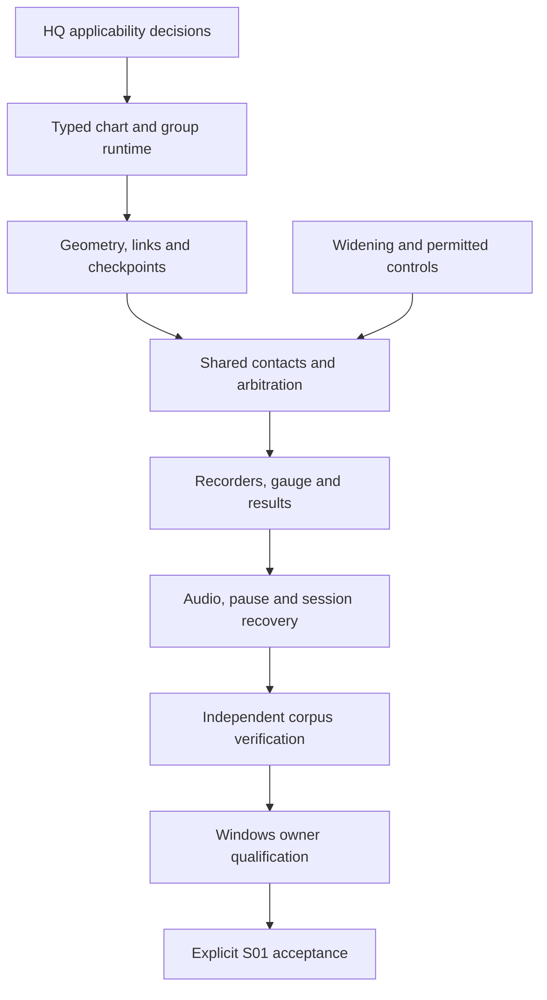

# S01 — Dependency register and execution plan

Subsystem OPEN. These are proposals for authorization, not new R milestones or a frozen compatibility profile. Requirement IDs and D01–D16 resolve in the adjacent registers. All executions publish exact production/test SHAs and event-level evidence; Work1 QA remains independent of Work2 implementation.

## Critical path

1. HQ-01 approves applicability and required platform/profile without deleting unresolved features.
2. Work1 establishes independent corpus/expectations and source-derived discriminating cases alongside Work2's chart/contact integration. Existing original fixtures are reused first.
3. Typed group-aware chart/runtime objects and geometry must support all required note types before general mixed arbitration can be qualified.
4. Group geometry, ownership/crossing, links/children and input candidates feed shared per-unit recorders. Widening/camera changes must feed both visible geometry and input projection.
5. Audio/lifecycle and session recovery apply to that integrated chart profile, not only a tap/hold fixture.
6. Exact-SHA independent verification, complete Windows corpus and owner G1–G8 acceptance close S01. Until then OPEN.

| Dependency | Blocks | Can proceed independently |
|---|---|---|
| D01/D02 typed chart/group generalization | Grouped long notes, general tempo/scroll and noinput integration | Existing-scope independent QA and G-series prerequisite analysis |
| D04/D05 geometry/cache/color ownership | Curved/crossing playable charts and all-type contact arbitration | Widening scalar/input implementation from E039 |
| D06/D07 original graph/child conflict expectations | Broad links, multiple children and same-point arbitration claims | Known linear/hold/group code integration |
| D03 widening lane pair and shared G/W state | Outer lanes, secondary candidates, extended geometry alignment | Audio/session resource work |
| D14/D15 permitted native control context | Native-owned camera reset/fade conclusions | READY ordinary functionality; isolated equations retain their limits |
| D16 genuine flick logic producer/applicability | Any native-equivalent playable flick claim | All known ordinary types |
| D08 owned character and gauge applicability | Skill/easy/hard/continuous-mode claims and campaign scope closure | No-ability component verification with explicit profile label |
| D10 independent corpus | G5 and systemic equivalence claims | Development tests remain useful but cannot substitute |
| D11–D13 complete audio/presentation/session | G6 representative use and owner qualification | Headless original-derived component comparisons |

## Proposed bounded assignments

### HQ-01 — Headquarters / required scope and dependency decisions
Minimum: approve a complete requirement inventory and decide each H row with evidence and consequences. Include G006/007/009/010 explicitly; no “blocked therefore out of scope” rule. Evidence: charter G1–G8, Scout003 and A01 source findings. Tests: register crosswalk and dependency completeness. Independent QA: Work1 reviews decisions for missing dependencies. Exclusions: no implementation or invented native applicability. Stop at recorded decisions, or one exact unresolved source question. Coverage: closes ambiguity, not functionality.

### W1-01 — Work1 / independent baseline and integration corpus
Minimum: independent executable expectations for the current supported R010 profile, plus raw/normalized/prepared fixtures and required future interaction cases. Depend on exact production SHA and available .NET/Godot toolchain; reuse reference_traces/r001,r004–r010 and original fixtures E024–E042. Test supported behavior and expected rejections, serialized intermediate fields, mixed hold/tap chronology, natural N7 weights, noinput flags, group depth/retention, offset/pause and complete result cleanup. Run historical regression at a corpus gate; report failures/skips and SHA. Independent QA: this is Work1's separate production execution, not relabeling Work2's reports. Exclude native experiments and GUI automation. Stop at verified scope ledger or reproducible first difference. Coverage: D10 and S01-16.90, establishes a reliable baseline while implementation proceeds separately.

### W2-01 — Work2 / coherent chart and continuous-note integration
Minimum: a single playable representative mixed chart using required curves, multiple permitted groups and note types, tempo changes, noinput, crossing ownership and resolved-record conservation. Dependencies: D01/02/04/05 and W1-02 expectations for broader graph/conflicts. Evidence: E002/003/004/009/010/028/029/036/038. Do not wait for new research where existing equations/fixtures already suffice. Preserve f32 stages, signed key/admission retention, unit weights, separate latches/activity/owners and resolved guards. Tests: parser profiles and rejections, geometry boundaries, same-input mixed candidate ledgers, crossing cache-order scenarios, all unit/counter/gauge/results, pause/replay mixed integration; full historical suite at integrated checkpoint. Independent QA: Work1 runs new original-derived corpus on exact commit. Owner: mixed chart physical play and target readability. Exclusions: unproven flick/special gauge/control paths. Stop at integrated profile delivery or one demonstrated research blocker, not an accumulation of disconnected “done” mechanics. Coverage: principal D01–D07 functional path.

### W1-02 — Work1 / bounded requirement closure pack
Minimum: close only the original facts actually preventing W2-01: graph/tolerance/child-parent and equal-time conflict behavior, accuracy consumer if required, and demanded special result flags. First use instruction-backed equations and existing fixtures; identify which facts still need native execution. Any native experiment requires separate authorization: one original owning entry/object chain, one positive case and discriminating negative, observed candidates/recorders/cleanup, instruction/time budget and stop at missing producer. E038 prepared/natural differences and E025 parent-mode limits must remain explicit. Independent QA: separately authored expectations plus source citations; no output from Work2 becomes oracle. Exclude unrestricted graph/mode exploration. Stop at reference pack or exact missing producer. Coverage: D06/D07/D09 and constrained acceptance boundaries.

### W2-02 — Work2 / chart controls with perceptual and input alignment
Minimum: play a chart containing E039 widening with visible/input agreement, secondary eligibility and outer-lane contacts; integrate required hidegroup/camera/fade only after applicability/evidence gates. Dependencies: D03, group-aware chart dispatch, HQ-01 and W1-03 where blocked. Evidence: E004/E007/E032/E039. Tests: strict event-time dispatch, interpolation-before-dispatch order, independent G/W, native-matched input probes, noinput versus hidegroup, resize/camera roundtrips, controlled visibility versus active-state distinction. Independent QA: Work1 event/geometry comparisons; owner verifies playable perception and physical targets. Exclusions: exact artwork/particles unless needed for play; no patched permission proof. Stop at complete controls profile or producer blocker. Coverage: D03/D12 and approved D14/D15 components.

### W1-03 — Work1 / prerequisite-first G-series decisions
Minimum: one separately authorized question per execution, chosen by HQ-01 criticality. G006: justified permitted chart/catalog ownership before admitted camera overlap/reset; compare same original child-action scene with/without reset and observe later transforms/JNI. G007: prove both kind0 construction and owner feature gate, then callback/key replacement versus no replacement. G009: locate original logic allocation/vtable/owning caller before gesture, with unchanged E033 tap/discard control; renderer allocation is already disconfirmed. G010: justified owned Character/current stats through original factory/activation/selector before gauge6 or11 trajectory; ordinary control is not special coverage. Expected observations and negative controls come from Scout003 P01–P04; do not repeat solved generic exclusion. FAIL means missing required provenance; blocked upstream stages remain NOT RUN. Stop at first absent prerequisite; never construct an account/renderer subsystem to force the experiment. Independent QA: preserved original instructions/fixtures and causal ledger. Coverage: applicability and D08/D14/D15/D16; no automatic gameplay implementation.

### W2-03 — Work2 / complete session and audible integration
Minimum: prepare a selected compatible chart/audio/metadata set, play it through offset/start, pause/resume and terminal cleanup, results and replay with documented configuration behavior. HQ decides whether persistent best records/general import are in S01 or external dependencies; a diagnostic log is not persistence. Evidence E005/E012/E013/E040/E041/E042. Dependencies: shared chart IDs/N/end/profile and stable core/input contracts. Tests: resource duration/format/missing-file errors, one start, stale-session protection, seek/unpause failure recovery, prestart and mid-long-note pause, focus/cancel/contact recovery, record/cache conservation and repeated replay; final clean Windows export and all resource hashes. Work1 independently checks exact production; owner judges audible/perceptual alignment and physical recovery. Exclude invented drift servo, device latency claims and online submission. Stop at usable full-profile session/package or precise backend blocker. Coverage: D11/D13 and G6 prerequisites.

### W1-04 / Owner — final campaign verification gate
Dependencies: every mandatory requirement implemented, all H decisions recorded, no unresolved unapproved required discrepancy. Work1 runs entire independent corpus and preserved suites at exact release SHA, verifies candidate/record/contact/clock/gauge intermediate results, full-session resource failures and replay. Work2 supplies reproducible build/export and package integrity. Owner alone performs physical Windows full-corpus qualification. Exclusions: none from declared mandatory scope. Stop at first unresolved required difference or reviewed G1–G8 acceptance evidence; only owner decides OWNER-ACCEPTED. Coverage: S01 as a subsystem, not a checkpoint count.

## W1-01 preparation update — 2026-11-15

Independent corpus/driver prepared:50 scenarios,38 RUNNABLE specifications,8 EXPECTED REJECTION,4 RESEARCH BLOCKED. Actual source/checksum preflight exit2/BLOCKED: SDK10.x absent; Godot4.6.3 standard does not satisfy4.7.2.NET. No production test executed; no requirement upgraded to INDEPENDENTLY VERIFIED. W1-01-B01/B02 must be resolved before baseline verification. G006/007/009/010 and D01–D16 unchanged. See [W1-01-report.md](W1-01-report.md). S01 OPEN.

## W1-01-C01 executed CLI checkpoint — 2026-11-16

Pinned production ab349d441dfa02f3c1ff97d6d0b8837c6ebb8f0e now independently executed:38 baseline+8 rejection cases pass,0fail/skip; repeat byte-identical. Four producer-blocked cases remain NOT VERIFIED. Official SDK10.0.402/runtime10.0.13 plus reference pack2.1.0 installed in isolated workspace. Historical13 CLI suites319checks and three standalone comparisons pass separately with Work2 provenance. See [W1-01-C01-report.md](W1-01-C01-report.md) and results/c01/receipt.json. Only asserted fields in this bounded corpus gain independent verification; broad requirement statuses remain OPEN. W1-01-B01 recovered for CLI; Godot4.7.2.NET is not needed for this driver. G006/007/009/010, D01–D16 completeness gaps remain. Next recommendation: authorized coherent Work2 W2-01 integration plus Work1 graph/child reference closure. No implementation begun; S01 OPEN.

## W2-01 mixed-profile development checkpoint — 2026-11-16

New explicit S01Mixed compatibility profile in shared production runtime. Partial
VERIFIED COMPONENT coverage only; existing immutable A01/R010 statements remain
historical. This does not close any complete S01 row, discrepancy or H decision.

| Requirement/dependency | Bounded coverage gained | Remaining / next verification |
|---|---|---|
|S01-01.01/02,D01|typed mixed notes/source/group/N/end; R010 profile preserved|full grammar and native abnormal/default branches OPEN|
|S01-07.01–04,D02|positive groups hold/arc/trace/link; shared E, own scales/index/lifetime; E029 taps/noinput coexist|reverse/noinput long notes and broader reversal OPEN|
|S01-04.01/03,D04|six E003 sine families, sampled cache/render/marker agreement|native-isolated equations only; cubic b/internal tempo changes OPEN|
|S01-04.02/04,D05|translated exact E028 crossing, sequential proximity, bypass release/500ms lifetime/two contacts|general crossings/equality200/one-contact native execution OPEN|
|S01-04.05,D06|E038 exact pair in positive independent group, flag0/1/fold/unit callbacks|graphs/tolerances/nonempty window/history OPEN|
|S01-05.01,D07|one E025 trace child grouped, fresh DOWN/guard, same runtime|multi-child/ordinary parent/general candidate conflicts OPEN|
|S01-10/11/12/14,D10–13|38-unit audible mixed bridge/nodes/results/replay/pause; L/R/touch transport|Work2 development only; exact new-production Work1 and owner pending|

Work1 driver/fixtures/oracles remain unchanged. Work2 reruns its46legacy cases via
the unchanged C# driver against current core/bridge R010 compatibility path. The
manifest's historical productionSha stays ab349d4 as provenance; outer execution
receipt records actual tested commit. Pinned-byte run.py is not misrepresented as
accepting changed source. Four original-producer cases stay NOT RUN/NOT VERIFIED.
No new independent Mixed-profile verification is claimed. G006/G007/G009/G010,
D03 widening, H decisions and every other required campaign gap remain OPEN.
Full449historical+new mixed/Godot/Windows execution evidence and exact source are
in ../../validation/S01-W2-01.md. Scope/acceptance authority remains Headquarters/
owner; do not initiate W1-02/W2-02 or another campaign from this checkpoint.

## W2-01 final executed technical evidence — 2026-11-16

Exact production 49e7c263a36aebcc0316e010a629c6bfdf205f6d; TECHNICAL PASS — READY FOR HUMAN QUALIFICATION, bounded VERIFIED COMPONENT only.484/484development groups (449prior+35new),46unchanged Work1 cases rerun by Work2,3standalone comparisons;0fail/skip;52commands exit0; complete Windows/PCK/runtime/CRC/extracted-hash checks pass. All historical requirement/discrepancy entries remain; no complete S01 coverage row/H decision is closed. New-profile independent Work1 and owner Windows/physical/audio qualification NOT RUN/PENDING. Four G006/G007/G009/G010 cases remain producer-blocked. S01Mixed zero-unit rejection is ENGINEERING unsupported-domain handling; native zero-unit behavior NOT VERIFIED. Full exact scope, inventory, receipts, limits and reproduction: ../../validation/S01-W2-01.md. S01 OPEN.

## QA-W2-01 independent new-production checkpoint — 2026-11-20

Work1 independently executed unchanged49e7c263a36aebcc0316e010a629c6bfdf205f6d:
37/37newS01Mixed cases (33runnable/4engineering rejection),16,760scalar assertions,
0fail/skip;46/46immutable historical Work1 cases with defaultR010 also pass.
Separately341Work2 CLI groups pass; their test authorship remains Work2. Three
comparator mutations correctly report the intended first differing field. No genuine
production divergence found in the final declared corpus. Draft oracle/adapter
errors and source-based corrections are preserved in QA-W2-01-report.md.
FourG006/G007/G009/G010 cases remain NOT RUN/NOT VERIFIED. Owner's already
reported six-group Windows qualification is preserved; no GUI/physical/audio
requalification or new native experiment performed. No S01 closure or scope waiver.

D10 exact-new-production CLI QA gate is satisfied for W2-01's declared corpus;
owner qualification is separately supplied. Headquarters may review W2-01 bounded
acceptance without another routine Windows test. D06/D07 broader graph/child/conflict
expectations still precede expanded integration; recommend separately authorized
Work1 W1-02 using existing evidence first. D03 widening/shared render/input G/W
can proceed under separate Work2 authority usingE039. HQ applicability and
G006/007/009/010 gates remain. No next bounded task was started.

Full checkpoint: [QA-W2-01-report.md](QA-W2-01-report.md). S01 OPEN.

QA fixture-review addendum: two new rejection charts corrected to valid AFF decimal timing tokens; all four now assert intended profile-guard messages. Entire37case suite rerun PASS,0fail/skip; original corpus/production unchanged. See QA-W2-01 authoring diagnostics; no coverage exclusion or expectation relaxation.

## W1-02 original graph/child/conflict source checkpoint — 2026-11-20

Status BLOCKED for generalized native-integrated closure; evidence-pack validation
PASS. Starting16d17765e6fe50251162a45ffd5d1a64f243acf5; accepted production
49e7c263a36aebcc0316e010a629c6bfdf205f6d assessed statically, no new runtime-tested
SHA.19bounded requirements/45AFF fixtures:5byte-identical historical controls and
40proposed scenarios NOT RUN.109instruction anchors, exact library identity and
child virtual relocations rechecked without executing ARM64. No production,
historical test/oracle, original report/harness or owner qualification change.

First blocker B01:original-owned trace/ordinary two-child factory/backlink/geometry/
count and judgment ledger (W102-P01), reusing E025ordinary entry and services.
B02small graph topology/triple continuity, B03actual mixed collected/sorted vector
and stops, B04nonempty group history/window need separately authorized bounded
observations if demanded. Existing comparator/guard/N7 contracts do not need
generic rediscovery. Next proposed Work2child/conflict integration depends on
P01/P03; broader graph integration on P02/P04. No new native execution authorized
or started here. E039widening remains independent; G006/007/009/010 unchanged.

## W102-P01 dependency disposition — 2026-11-20

**B01 / D07 partially resolved, still OPEN.** Source `e780629894646da3fbf32e7fb6881006d1453f09`
executed exactly three scenes. Two-child trace construction/count/child judgment
and negative controls now have native-integrated evidence; repeating generic E025
ownership discovery is unnecessary. Raw false/two-child input also constructs
real children but prepares mode1/N2, contradicting the conditional mode0/N5 model.
Raw AFF flag and prepared mode must be separate normalization fields in future
fixtures and implementation acceptance tests.

The Scene3 host mode assertion interrupted judgment. It is a harness prerequisite
error, not a missing native producer or engine rejection. No fresh scene remains
authorized. Headquarters should review the measured conversion and decide whether
to authorize one-scene P01-C01: the identical false/two-child fixture, observing
prepared mode1 without forcing it, then fresh-DOWN/negative/recorder/cleanup checks.
Do not attempt to manufacture ordinary body+children or preserve predicted N5.

Future Work2 child integration requires explicit raw-to-prepared mode handling,
native-backed child input/recording contracts, production negatives and independent
QA; generalized conflict behavior still depends on separately authorized P03.
Graph P02/P04, E039 widening and G006/007/009/010 remain separate unresolved work.
No implementation or additional native experiment started. Full scope and ledger:
[W102-P01-report.md](W102-P01-report.md). S01 OPEN.

## W102-P01-C01 native judgment recovery — 2026-11-20

VERIFIED CHECKPOINT for the one-scene raw-false/two-child profile only. Starting
c4e4c219214e3a55a4ffcab550ec59485d67e550; exact executed harness
fd11c2e013831f010412d4457fca04d85df7c2e9. Native library SHA256
3eaca4e6dabb3395f276f8915698d57675757d0df0970e716b23a3dc201c79be.
One fresh scene exit0; no retry. Parsed0 -> prepared1/N2; read-only c66654 before
and c66658 after hooks now directly observe the normalization store. Children
1250/1500 each PURE once; displaced, fresh-ID duplicate and retained MOVE/frame
negatives preserve state. Two recorder callbacks, intermediate exact binary32
health/score, contact IDs and cleanup confirmed. Offline385/385 comparisons with
immutable P01 trace Scene2 and E006 math PASS,0fail/skip; no compared gameplay
first difference. Conditional mode0/N5 remains refuted for this fixture.

S01-05.01 / W102-C01–C05 / D07 B01 gains the missing raw-false fixture child-input
ledger. No mode0 body+children, simultaneous tie or arbitrary child profile is
claimed. Original parent checkpoint vector exists but stays unresolved/uncounted
in observed mode1. P01/W1-02 historical BLOCKED records remain unchanged.
P03 still required for general tied/mixed candidate ordering and stops; separately
authorized Work1 evidence precedes generalized Work2 conflict integration. No P03
or implementation executed. Production/Windows/GUI/results NOT RUN. All prior
original/reconstruction/QA evidence preserved. Full report and receipts:
W102-P01-C01-report.md and w102-p01-c01/. S01 subsystem OPEN; all other gates remain.

## W102-P03 mixed candidate checkpoint — 2026-11-20

BLOCKED at original Scene A activation by unhandled host asin import1a6e300,
caller/LR17d26c8. Start69b2b272cff47211091da767840f16a9d56b943b; exact executed
harness f595c7e4bce057efa02d3d587900045e7680effe; original library identity unchanged.
One fresh scene reserved before setup, exit1; 0completed,1blocked,3NOT RUN,0retries.
Tap1500, hold1500–2500 and child1500 factories returned; parent backlink/geometry
stores and count-helper N5 for this mixed chart observed. Activation/index/input
eligibility not established. No JNI input, candidate permutation, classifier stop,
recording/health or cleanup observed. Static/offline evidence checks do not count
as native gameplay passes. B03 / D07 / W102-A01–A05 and S01-10.01 remain OPEN.
Two-retained fixture has no hold; do not claim it validates hold-latch arbitration.

No original rejection, managed stable-sort oracle, production divergence or broad
feature exclusion is inferred. Prior E004/E025/E035/E037 and P01/C01 evidence intact.
Recommend separately authorized Work1 asin double ABI recovery/isolated numerical
controls and one fresh identical Scene A, not an automatic retry. No B–D or other
experiment executed; Work2/Windows/results NOT RUN. Full source/provenance/receipts:
campaigns/S01-normal-gameplay/W102-P03-report.md and w102-p03/. S01 OPEN.

## W2-02 widening integration checkpoint — 2026-11-21

D03 / S01-08.01 / S01-02.01 / S01-10.05 / D12 / S01-13.01 gain bounded VERIFIED COMPONENT coverage: E039 typed group0 one opening control, separate authoritative G/W/previousG, strict frame dispatch and scalar order, actual-coordinate primary/secondary selector and shared retained contacts; engineering gold/outer meshes/real camera projection, five chart choices and full practice results. Focused21core+14Godot pass; full exact-source regression/export pending. Existing historical entries/prefixes unchanged. No full discrepancy/requirement closure; Work1 independent new-source QA/owner Windows qualification pending. Closing/grouped/multiple controls, native visible FOV/meshes, broader normal-gameplay and all original G-series/P03 blockers remain OPEN/NOT VERIFIED. No new native experiment, no mixed-sort recovery. Full report ../../validation/S01-W2-02.md; S01 OPEN.

## W2-02 final executed evidence — 2026-11-21

D03/S01-08.01 and bounded D12 input/presentation integration VERIFIED COMPONENT at exact production068a2f09698417b0ddd09e81ec274e758109a0bf: E039 one positive group0 opening control, separate G/previousG/W, strict interpolate-before-dispatch chronology, actual-coordinate primary/secondary shared contact input, engineering gold/outer geometry and full audible13/11practice/results/replay.519/519development groups, unchanged37+46Work1 development-rerun cases,3standalone comparisons;0fail/skip;57commands0. Actual Godot import/build/headless and complete Windows export/PCK26charts/music/runtime/CRC/extracted hashes PASS.81field external serialized native audit matches E039 through1501; later results are reconstructed.

VERIFIED CHECKPOINT — READY FOR HUMAN QUALIFICATION; new exact-source independent Work1/owner Windows physicalaudioGUI NOT RUN/PENDING. No complete requirement/discrepancy closed. Closing/grouped/multiple/negative controls, native rendering/FOV, broader mixed-tie/graph/child and G006/G007/G009/G010/P03 requirements stay OPEN/NOT VERIFIED. Immutable source/fixture/test/history expectations preserved. Full report/receipts/changed paths/limitations: ../../validation/S01-W2-02.md. Next actor HQ schedules independent verification/owner; no new assignment executed. S01 OPEN.
