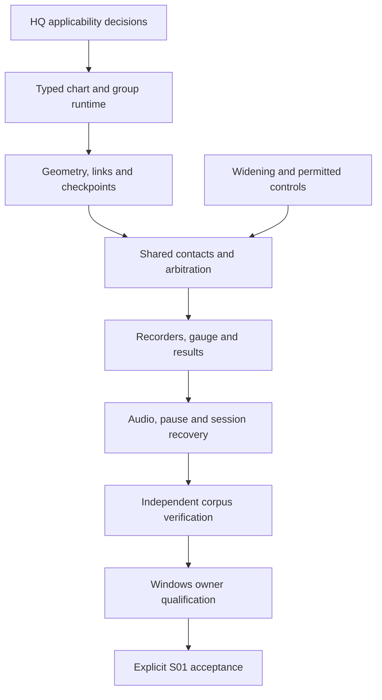

# S01 — Dependency register and execution plan

Subsystem OPEN. These are proposals for authorization, not new R milestones or a frozen compatibility profile. Requirement IDs and D01–D16 resolve in the adjacent registers. All executions publish exact production/test SHAs and event-level evidence; Work1 QA remains independent of Work2 implementation.

## Critical path

1. HQ-01 approves applicability and required platform/profile without deleting unresolved features.
2. Work1 establishes independent corpus/expectations and source-derived discriminating cases alongside Work2's chart/contact integration. Existing original fixtures are reused first.
3. Typed group-aware chart/runtime objects and geometry must support all required note types before general mixed arbitration can be qualified.
4. Group geometry, ownership/crossing, links/children and input candidates feed shared per-unit recorders. Widening/camera changes must feed both visible geometry and input projection.
5. Audio/lifecycle and session recovery apply to that integrated chart profile, not only a tap/hold fixture.
6. Exact-SHA independent verification, complete Windows corpus and owner G1–G8 acceptance close S01. Until then OPEN.

| Dependency | Blocks | Can proceed independently |
|---|---|---|
| D01/D02 typed chart/group generalization | Grouped long notes, general tempo/scroll and noinput integration | Existing-scope independent QA and G-series prerequisite analysis |
| D04/D05 geometry/cache/color ownership | Curved/crossing playable charts and all-type contact arbitration | Widening scalar/input implementation from E039 |
| D06/D07 original graph/child conflict expectations | Broad links, multiple children and same-point arbitration claims | Known linear/hold/group code integration |
| D03 widening lane pair and shared G/W state | Outer lanes, secondary candidates, extended geometry alignment | Audio/session resource work |
| D14/D15 permitted native control context | Native-owned camera reset/fade conclusions | READY ordinary functionality; isolated equations retain their limits |
| D16 genuine flick logic producer/applicability | Any native-equivalent playable flick claim | All known ordinary types |
| D08 owned character and gauge applicability | Skill/easy/hard/continuous-mode claims and campaign scope closure | No-ability component verification with explicit profile label |
| D10 independent corpus | G5 and systemic equivalence claims | Development tests remain useful but cannot substitute |
| D11–D13 complete audio/presentation/session | G6 representative use and owner qualification | Headless original-derived component comparisons |

## Proposed bounded assignments

### HQ-01 — Headquarters / required scope and dependency decisions
Minimum: approve a complete requirement inventory and decide each H row with evidence and consequences. Include G006/007/009/010 explicitly; no “blocked therefore out of scope” rule. Evidence: charter G1–G8, Scout003 and A01 source findings. Tests: register crosswalk and dependency completeness. Independent QA: Work1 reviews decisions for missing dependencies. Exclusions: no implementation or invented native applicability. Stop at recorded decisions, or one exact unresolved source question. Coverage: closes ambiguity, not functionality.

### W1-01 — Work1 / independent baseline and integration corpus
Minimum: independent executable expectations for the current supported R010 profile, plus raw/normalized/prepared fixtures and required future interaction cases. Depend on exact production SHA and available .NET/Godot toolchain; reuse reference_traces/r001,r004–r010 and original fixtures E024–E042. Test supported behavior and expected rejections, serialized intermediate fields, mixed hold/tap chronology, natural N7 weights, noinput flags, group depth/retention, offset/pause and complete result cleanup. Run historical regression at a corpus gate; report failures/skips and SHA. Independent QA: this is Work1's separate production execution, not relabeling Work2's reports. Exclude native experiments and GUI automation. Stop at verified scope ledger or reproducible first difference. Coverage: D10 and S01-16.90, establishes a reliable baseline while implementation proceeds separately.

### W2-01 — Work2 / coherent chart and continuous-note integration
Minimum: a single playable representative mixed chart using required curves, multiple permitted groups and note types, tempo changes, noinput, crossing ownership and resolved-record conservation. Dependencies: D01/02/04/05 and W1-02 expectations for broader graph/conflicts. Evidence: E002/003/004/009/010/028/029/036/038. Do not wait for new research where existing equations/fixtures already suffice. Preserve f32 stages, signed key/admission retention, unit weights, separate latches/activity/owners and resolved guards. Tests: parser profiles and rejections, geometry boundaries, same-input mixed candidate ledgers, crossing cache-order scenarios, all unit/counter/gauge/results, pause/replay mixed integration; full historical suite at integrated checkpoint. Independent QA: Work1 runs new original-derived corpus on exact commit. Owner: mixed chart physical play and target readability. Exclusions: unproven flick/special gauge/control paths. Stop at integrated profile delivery or one demonstrated research blocker, not an accumulation of disconnected “done” mechanics. Coverage: principal D01–D07 functional path.

### W1-02 — Work1 / bounded requirement closure pack
Minimum: close only the original facts actually preventing W2-01: graph/tolerance/child-parent and equal-time conflict behavior, accuracy consumer if required, and demanded special result flags. First use instruction-backed equations and existing fixtures; identify which facts still need native execution. Any native experiment requires separate authorization: one original owning entry/object chain, one positive case and discriminating negative, observed candidates/recorders/cleanup, instruction/time budget and stop at missing producer. E038 prepared/natural differences and E025 parent-mode limits must remain explicit. Independent QA: separately authored expectations plus source citations; no output from Work2 becomes oracle. Exclude unrestricted graph/mode exploration. Stop at reference pack or exact missing producer. Coverage: D06/D07/D09 and constrained acceptance boundaries.

### W2-02 — Work2 / chart controls with perceptual and input alignment
Minimum: play a chart containing E039 widening with visible/input agreement, secondary eligibility and outer-lane contacts; integrate required hidegroup/camera/fade only after applicability/evidence gates. Dependencies: D03, group-aware chart dispatch, HQ-01 and W1-03 where blocked. Evidence: E004/E007/E032/E039. Tests: strict event-time dispatch, interpolation-before-dispatch order, independent G/W, native-matched input probes, noinput versus hidegroup, resize/camera roundtrips, controlled visibility versus active-state distinction. Independent QA: Work1 event/geometry comparisons; owner verifies playable perception and physical targets. Exclusions: exact artwork/particles unless needed for play; no patched permission proof. Stop at complete controls profile or producer blocker. Coverage: D03/D12 and approved D14/D15 components.

### W1-03 — Work1 / prerequisite-first G-series decisions
Minimum: one separately authorized question per execution, chosen by HQ-01 criticality. G006: justified permitted chart/catalog ownership before admitted camera overlap/reset; compare same original child-action scene with/without reset and observe later transforms/JNI. G007: prove both kind0 construction and owner feature gate, then callback/key replacement versus no replacement. G009: locate original logic allocation/vtable/owning caller before gesture, with unchanged E033 tap/discard control; renderer allocation is already disconfirmed. G010: justified owned Character/current stats through original factory/activation/selector before gauge6 or11 trajectory; ordinary control is not special coverage. Expected observations and negative controls come from Scout003 P01–P04; do not repeat solved generic exclusion. FAIL means missing required provenance; blocked upstream stages remain NOT RUN. Stop at first absent prerequisite; never construct an account/renderer subsystem to force the experiment. Independent QA: preserved original instructions/fixtures and causal ledger. Coverage: applicability and D08/D14/D15/D16; no automatic gameplay implementation.

### W2-03 — Work2 / complete session and audible integration
Minimum: prepare a selected compatible chart/audio/metadata set, play it through offset/start, pause/resume and terminal cleanup, results and replay with documented configuration behavior. HQ decides whether persistent best records/general import are in S01 or external dependencies; a diagnostic log is not persistence. Evidence E005/E012/E013/E040/E041/E042. Dependencies: shared chart IDs/N/end/profile and stable core/input contracts. Tests: resource duration/format/missing-file errors, one start, stale-session protection, seek/unpause failure recovery, prestart and mid-long-note pause, focus/cancel/contact recovery, record/cache conservation and repeated replay; final clean Windows export and all resource hashes. Work1 independently checks exact production; owner judges audible/perceptual alignment and physical recovery. Exclude invented drift servo, device latency claims and online submission. Stop at usable full-profile session/package or precise backend blocker. Coverage: D11/D13 and G6 prerequisites.

### W1-04 / Owner — final campaign verification gate
Dependencies: every mandatory requirement implemented, all H decisions recorded, no unresolved unapproved required discrepancy. Work1 runs entire independent corpus and preserved suites at exact release SHA, verifies candidate/record/contact/clock/gauge intermediate results, full-session resource failures and replay. Work2 supplies reproducible build/export and package integrity. Owner alone performs physical Windows full-corpus qualification. Exclusions: none from declared mandatory scope. Stop at first unresolved required difference or reviewed G1–G8 acceptance evidence; only owner decides OWNER-ACCEPTED. Coverage: S01 as a subsystem, not a checkpoint count.

## W1-01 preparation update — 2026-11-15

Independent corpus/driver prepared:50 scenarios,38 RUNNABLE specifications,8 EXPECTED REJECTION,4 RESEARCH BLOCKED. Actual source/checksum preflight exit2/BLOCKED: SDK10.x absent; Godot4.6.3 standard does not satisfy4.7.2.NET. No production test executed; no requirement upgraded to INDEPENDENTLY VERIFIED. W1-01-B01/B02 must be resolved before baseline verification. G006/007/009/010 and D01–D16 unchanged. See [W1-01-report.md](W1-01-report.md). S01 OPEN.

## W1-01-C01 executed CLI checkpoint — 2026-11-16

Pinned production ab349d441dfa02f3c1ff97d6d0b8837c6ebb8f0e now independently executed:38 baseline+8 rejection cases pass,0fail/skip; repeat byte-identical. Four producer-blocked cases remain NOT VERIFIED. Official SDK10.0.402/runtime10.0.13 plus reference pack2.1.0 installed in isolated workspace. Historical13 CLI suites319checks and three standalone comparisons pass separately with Work2 provenance. See [W1-01-C01-report.md](W1-01-C01-report.md) and results/c01/receipt.json. Only asserted fields in this bounded corpus gain independent verification; broad requirement statuses remain OPEN. W1-01-B01 recovered for CLI; Godot4.7.2.NET is not needed for this driver. G006/007/009/010, D01–D16 completeness gaps remain. Next recommendation: authorized coherent Work2 W2-01 integration plus Work1 graph/child reference closure. No implementation begun; S01 OPEN.
