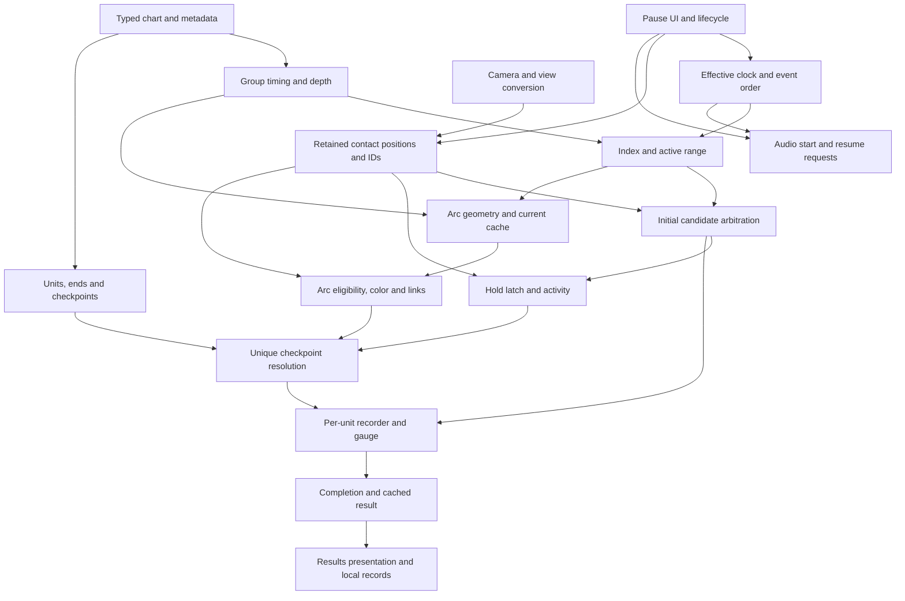

# Scout 003 — Native gameplay coverage and reconstruction gap audit

Date: 2026-11-05 (Asia/Bangkok). Work 1, Project Arconist.

## Result

**PASS — source-grounded audit and bounded proposals complete.** This is an audit result, not a new native-execution result or an R-series implementation acceptance. The submitted mission is treated as authorization to perform and publish Scout 003 only. No R004, new expedition, reconstruction change, graphical interaction or input injection is performed.

Audited `main` at **1341347b7994b1f99e2a20fdb47e163df4451fef**, tree **ef9e515b8c0e657578c25a94e5555ca07dc11460**. The owner's current mission states that R003-C01 passed owner qualification; that is the baseline acceptance authority for this audit. The repository's earlier R003 FAIL, C01 READY FOR HUMAN QUALIFICATION and pending-owner text remain historical records, unchanged. Acceptance does not expand their tap-only implementation scope.

The primary library was freshly verified directly from the supplied read-only ZIP:

| Identity | Actual Scout 003 observation |
|---|---|
| Member | `lib/arm64-v8a/libcocos2dcpp.so` |
| Length | 29,217,504 bytes |
| SHA-256 | `3eaca4e6dabb3395f276f8915698d57675757d0df0970e716b23a3dc201c79be` |
| ELF | ELF64, little endian, AArch64 (`e_machine=183`) |
| GNU Build ID | `17d660edbf37ca78beefc32e07672c97419ddce6`; GNU type-3 note descriptor at file offset `0x2e0` |

**Execution status:** new ARM64 experiments NOT RUN; existing native regressions NOT RERUN; C#/Godot builds/tests NOT RERUN; graphical qualification NOT RUN by Work 1. Published earlier executions are cited with their original scopes. The current audit verifies source, fixtures, references, archive identity, document consistency and preservation. This documentation-only task does not need a new runtime qualification. This host has Python 3.12.14, but no `dotnet`, Unicorn or pyelftools installed; no dependency installation or substitute gameplay experiment is attempted.

## What I Found

The independent kernel and Godot bridge implement **ordinary taps only**. Native recovery is much broader: bounded ordinary holds, arc-taps, moving arcs, linked arcs, chords, independent/reversed timing groups, noinput, widening, settings offsets, interruption and mixed-result recovery already have connected native evidence. These need reconstruction work, not another general reconnaissance expedition.

Four backlog gates remain blocked: **G-006 camera overlap/reset, G-007 track-fade scheduling, G-009 FlickNote production, G-010 continuous gauges 6/11**. Later E039 closes widening admission/input effects without closing camera or track-fade admission. E040/E041 close important settings and native-owned pause-UI connections without establishing audible FMOD output or Android queue behavior. Reports E035–E042 explicitly preserve the blocked flick/gauge/camera/fade diagnostics; none supplies a later FlickNote producer closure.

A native-integrated fixture is bounded evidence, not a general compatibility claim. In particular, ordinary arc gameplay is implementable in a declared subset; arbitrary mixed tap/hold/arc/arc-tap conflicts, branching arc links, special modes and physical touch delivery are not all verified by those separate fixtures.

### Sources and audit method

Read the supplied authoritative project introduction, root README, cumulative research context, backlog G-001–G-018 and its decision history; reviewed the relevant findings, evidence boundaries and superseding conclusions across E001–E042, including E030-R. The source ledger below identifies their roles. Reviewed actual core/bridge/frontend code, tests, AFF fixtures, native scenario assertions and R001–R003/C01 validation records. Historical generated JSON/evidence ZIPs are not represented as fresh observations.

Reconstruction source anchors at the audited commit:

| Source | Actual implementation boundary |
|---|---|
| [Chart.cs](../reconstructed/core/Chart.cs) | Only Tap/Timing types. Positive finite default timing, integer taps/raw lanes0–5, two headers; requires timing at0, distinct timing times and at least one tap. N=tap count; end=last tap+120. Unsupported grammar throws. No hold/arc/control/group objects. |
| [Kernel.cs](../reconstructed/core/Kernel.cs) | Ordinary steady Timeline/start compensation; positive timing integrator; tap buckets/active list; DOWN chronological candidates and guards, UP cleanup; ordinary counters/score/gauge/completion/cache. Contacts retain generated IDs, not continuous positions/lanes. No MOVE, long-note state, audio callback, pause or skill mode. |
| [GameplaySession.cs](../reconstructed/godot/bridge/GameplaySession.cs) | Fresh Kernel on Start; D/F/J/K and pointer100 DOWN/UP; held-key/echo guards; FRAME callback ordering. No pause, movement, audio or configuration arguments exposed by Start. |
| [Main.cs](../reconstructed/godot/Main.cs) | Two bundled chart choices, HUD/result/replay, keyboard and one mouse-button contact. Mouse projection only on DOWN. Focus loss releases contacts and time continues. No touch-screen/mouse-motion gameplay path. |
| [SpatialTrack.cs](../reconstructed/godot/SpatialTrack.cs) | Perspective Camera3D, four ground lanes, tap BoxMeshes, depth from core time, ground-ray picking. Fixed FOV65, one camera, bounded X clipping, immediate hide on resolve are explicit substitutions. F6 view change is not AFF camera control. |
| [Core tests](../reconstructed/tests/Program.cs), [bridge tests](../reconstructed/godot/tests/Program.cs), [spatial checks](../reconstructed/godot/SpatialValidation.cs) | Test source reviewed, not executed here. Prior delivery records: 36 core +15 bridge +30 headless spatial groups, three normalized native-reference CLI comparisons, zero failures/skips in C01. Counts are historical technical evidence, never human play evidence. |
| [R001 references](../reference_traces/r001/README.md) | Manually normalized published native observations/instruction-backed fields; not raw native traces or reconstruction-generated goldens. Only ordinary/E035 schedules. |
| [R001](../reconstructed/validation/R001.md), [R002](../reconstructed/validation/R002.md), [R003](../reconstructed/validation/R003.md), [C01](../reconstructed/validation/R003-C01.md), [history](../reconstructed/contexts.md) | Preserve engineering PASS versus failure versus export repair versus owner acceptance. Historical automated R002 GUI testing is not permission to repeat it. |

### Classification rules

**NI = native-integrated**, original instructions joined in the report's declared environment; **NX = native-isolated**, enclosing state/caller supplied; **IB = instruction-backed**; **IN = inferred**; **BL = blocked**; **UN = unknown**. Multiple labels in a row deliberately separate a recovered component from an unverified extension. NI never means a full Android app, hardware audio, GPU image or unbounded chart support.

Reconstruction states: **Implemented** within the stated subset; **Partial** when only a component exists; **Absent**; **Incompatible** when the current rule intentionally differs from native behavior. Readiness: **READY** for the explicitly bounded behavior using existing research; **PARTIAL** when a narrower useful component can be implemented but the larger claim needs verification; **BLOCKED** when a required producer/integration prerequisite is missing; **UNKNOWN** when behavior is insufficiently established. READY does not waive Work 2 development tests, independent verification or owner qualification.

In the matrices, E-numbers link through the source ledger. Every address is an original main-library ELF virtual address unless explicitly marked FMOD provider. “Work 2” means a proposed implementation within the row's scope; “Pxx” refers to a precise, **unexecuted** Work 1 proposal below.

## A. Complete gameplay gap matrix

### A1. Chart and timeline

| Feature | Original evidence | Confidence | Reconstruction state | Dependencies | Blocking uncertainty | Readiness | Recommended next step |
|---|---|---|---|---|---|---|---|
| Typed AFF grammar and headers | E002 `0x923240`, integer/float helpers; E010 `0x1870de0`, `0x10dbff8` | NI valid fixtures; IB broader grammar | Partial: tap/timing regex subset only | Parser, chart | Invalid/exponent/locale/nonfinite compatibility is not complete | READY for documented valid subset; PARTIAL for full compatibility | Work 2 extend per mechanic; keep explicit unsupported/error policy rather than mimic native noncompletion |
| Whole chart initialization and judgment units | E010 `0x173b358→0x1862a14`, count `0x11ea120` before bars; E038/E036 refinements | NI | Partial: N=taps, end=last tap+120 | Parser, runtime, results | Special chart/digest flags and zero-unit charts remain bounded | READY ordinary supported objects | Work 2 introduce typed initialization and per-unit counting; bars never inflate N |
| Independent timing groups | E029 `native_timing_group.aff`, per-group `0xcf918c`, `0x1576aa4` | NI | Absent | Parser, group timing, index/render | Arbitrary attributes/group lifetime variants not covered | READY empty ordinary groups | Work 2 add group-local timing/depth/index; preserve group identity |
| Requested speed and tempo changes | E010 `0xe17528`, `0xbe2b98`; E029 requested4→4.044943809509277 with metadata178 | NI | Implemented positive default-group integrator; speed/base BPM constructor only | Metadata, timing | Metadata/special-flag breadth absent | READY ordinary positive timing | Work 2 preserve f32 stages and requested versus effective speed; expose bounded settings later |
| Negative BPM / reverse scroll | E007 isolated scroll; E029 `native_reverse_scroll.aff` at1200/−60 | NI bounded group; NX wider arithmetic | Absent: positive-only validation | Parser, timing, signed index, rendering | General fresh-jump/reversal extrema not established by one retained-tap fixture | READY tested reverse path; PARTIAL arbitrary charts | Work 2 preserve admission hysteresis and signed calculations; P06 only for broader claim |
| Negative timestamps and unusual numeric grammar | E002 leading minus emits float; E010 malformed lexer limits | IB / UN | Absent: nonnegative integer time required | Parser, runtime | Negative integer-position/time grammar and downstream validity not established | UNKNOWN full behavior | P10 only if actual required content needs it; keep rejection until then |
| `noinput` | E036 `0x8c8a14→0x18640f4`, N branch `0x11ea188`, expiry `0xf80654`; paired fixtures | NI ordinary taps | Absent | Parser, N/end, index, input, result | No-input holds/arcs not joined in that pair; rendering not proved absent | READY tap semantics; PARTIAL all types | Work 2 preserve indexed/active disabled objects while excluding input/N/end/expiry; P07 for long-note extension |
| Lane widening / secondary eligibility | E039 `0x1792e18`, strict `0xf8071c`, `0x1514c64`, G/W stores `0x10a763c/0x10a76f8`; three fixtures | NI | Absent; Down only2–5 and ground picker clips X | Parser, frame, input, rendering | Visible widening consumers remain partial | READY gameplay G/W paths | Work 2 implement both transitions and lane pair; do not call kind5 a demonstrated FOV change |
| Chart completion and unit reconciliation | E006/E009 `0x10a7b38`, `0x1600bb0`; E036/E042 completion/cache | NI ordinary; IB special extensions | Implemented taps only | Clock, active list, N, result | Special+6000/+2000 and result flags lack ordinary producer proof | READY ordinary | Work 2 use supported-object end rules; final LOST is not retroactive miss damage |
| AFF/user/profile offsets | E005; E040 Settings owner `0x1a146a0→0x1a02b48`, add `0xfbff4c`, store `0xfbff54` | NI settings→judgment; IB missing-key defaults | Partial: chart+supplied user integer; no frontend profile/backend | Config, chart, clock, audio | Real route detection/preferences file parsing absent | READY ordinary profiles/legacy rule | Work 2 add configuration boundary and explicit profile; preserve migration exactly once |
| Preroll, startup and effective clock | E005/E040 `0x8db04c`, `0x16c90bc`, request `0x16c9194`, C/B stores | NI clock/request; IB full alternatives | Partial: steady A0 branch and MusicStarted latch, silent | Clock, audio adapter | Audible scheduling/backend readiness unmeasured | READY contract; PARTIAL backend equivalence | Work 2 connect request callback without making audio position authoritative |
| Synchronization, seek and drift | E005 `0x9e74f4`, `0xa19088`; FMOD provider `0x270a8/0x35b38` | NI resume requests E041; NX/IB provider math; UN drift policy | Absent | Clock, audio, lifecycle | No demonstrated continuous drift servo, output latency or all adjustment-mode state | READY ordinary resume request; PARTIAL advanced seek | Work 2 ordinary E−B seek; P08 for extra modes; never invent a native drift controller |

### A2. Note mechanics

| Feature | Original evidence | Confidence | Reconstruction state | Dependencies | Blocking uncertainty | Readiness | Recommended next step |
|---|---|---|---|---|---|---|---|
| Ordinary ground taps | E002 `0x160ce28/0x965e28`; E024/E035/E042 | NI | Implemented bounded ordinary lanes2–5 | Parser, clock, input, recorder | Equal-start stability and unusual positions unverified | READY | Preserve existing core/oracles while adding types |
| Ordinary hold construction/checkpoints | E001 `0x17cb97c/0xd92558`; E026/E037 whole AFF→factory `0x1446490` | NI; IB other interval/duration branches | Absent | Parser, long-note records, N/end/index | Broad tempo/short/zero-duration edge cases need declared scope | READY positive ordinary hold subset | Work 2 R004; no artificial start/release judgment |
| Hold latch, activity and reacquisition | E026 `0xeec6f0`, reset `0x1866038`, activation `0x14557b4`; native_hold.aff | NI | Absent | Retained contacts, frame order, release | No persistent exclusive hold owner is established | READY | Work 2 distinct latch/activity/resolution; replacement contact can sustain |
| Hold versus same-lane taps | E037 A1/A2/B, `0xeec6f4` stop, consumed guard then continuation | NI three histories | Absent | Candidate sort, initial/continuous split | Arbitrary equal-start/all-type conflict policy remains unverified | READY observed mixed holds/taps | R004 reproduce hold-first starvation and tap-first two-DOWN path; do not “fix” native order |
| Ordinary arc geometry | E003 `0x1925084/0x180a190`; E028 moving native geometry, native_moving_arc.aff | NI linear moving; NX other curve math | Absent | Parser, geometry, timing, cache, renderer | Degenerate curves/height production and exact visual topology bounded | READY linear gameplay; PARTIAL full curve/fidelity | Work 2 initial linear arc; port literal arithmetic when adding curves |
| Continuous arc eligibility and ownership | E009 `0xc98490→0x927384→0x15dfe2c→0x15a90c4`; E028 | NI under services; NX wider ownership boundaries | Absent | Continuous positions, camera, color IDs | Arbitrary mode/color/branching/release histories not all joined | READY ordinary bounded path | Work 2 shared LogicColor equivalent and global claimed IDs; separate contact departure from UP |
| Arc checkpoints and result recording | E009 ordinary arc→GameResult; E028 actual unique records; E038 weighted calls | NI scoped | Absent | Geometry cache, activity, long-note recorder, gauge/N | Moving/linked native-owned fixtures stop before results | READY component composition; PARTIAL universal end-to-end claim | Work 2 preserve per-unit recorders and run completed reconstructed arc sessions; P05 for unverified conflicts |
| Moving/crossing arc color bypass | E028 `0x19f439c/0x19f43a0`, native_crossing_arcs.aff | NI two contacts; NX E009 one-contact prepared overlaps | Absent | Cache update order, colors, continuous input | Exact distance200 and one-contact moving crossing not swept | READY tested two-contact behavior | Work 2 retain sequential mixed-cache comparisons and timestamp+500 expiry; P05 for expanded scope |
| Connected arc linking/checkpoint production | E038 `0x125e474`, defaults `0x178f8fc`, successor `0x125e784`, fold `0xba8274/78` | NI constant two-segment chain | Absent | Chart linking, geometry, record weights, color/group | Branching/curved/near-tolerance connection coverage partial | READY two-segment subset | Work 2 later separate milestone; root0/successor1, N7, preserve link/group state |
| Arc-tap parent/child production and judgment | E025 `0x173a778`, parent link `0x1865514`, `0xc78814`, native_arc_tap.aff | NI one trace-parent child; IB other branches | Absent | Arc parent geometry, child collection, initial spatial input, recorder | Broad parent modes/multiple-child conflicts not joined | READY tested arc-tap subset | Work 2 standalone arc-tap milestone after sky projection; child is tap-tier judged once |
| Flick gesture and timing | E009 `0x16e0548`: distance>106, angle<45°, bound ID; E033 builder discard `0x1864628` | NX predicate; IB callers; BL producer | Absent | Reachable logic factory, coordinates, input, recorder | No original LogicFlickNote constructor/vtable/owning caller found | BLOCKED | P03 producer-first; a renderer/parser/RTTI name is insufficient |
| Simultaneous separated-lane chords | E027 native_chord.aff, both DOWN orders, two retained Touches at E1500 | NI two software deliveries | Partial: independent keyboard IDs supported; no chord-native oracle in core suite | Contact identity, input ordering, taps | Atomic MotionEvent batching/physical simultaneity not covered | READY two-lane semantics | Work 2 add independent native-normalized chord validation; retain IDs across DOWN/UP |
| General mixed-note arbitration | E004 signed-start comparator; E035 tap/tap; E037 hold/tap; E025 child path | NI specified pairs; IB/UN all combinations | Partial: taps only | All candidate types, shared input, continuous pass | Hold/arc/child/flick conflicts and equal-start stability are not collectively tested | PARTIAL | Implement proven pairs now; P05 for one demanded conflict, not a universal policy |

### A3. Input lifecycle

| Feature | Original evidence | Confidence | Reconstruction state | Dependencies | Blocking uncertainty | Readiness | Recommended next step |
|---|---|---|---|---|---|---|---|
| Initial selection, sorting, consuming return | E004 `0xeec024/0xf6b514`; E035/E037 | NI; IB comparator | Implemented taps, source-ordinal equal-time tie substitution | Input, active list, clock | Equal-start sort stability unknown | READY distinct-start subset; PARTIAL equal ties | Preserve chronological signed-start key and guards; P05 if tie fidelity is needed |
| Continuous contact movement | E011 JNI `0x1706960→0x160b710`; E028 nine MOVE arrays | NI under JNI-array service | Absent: mouse DOWN/UP only | Contact positions/current/previous, projection, frame | Actual Android queue and malformed arrays outside coverage | READY software contract | Work 2 add MOVE/retained positions without judging taps again on MOVE |
| Three contact identities and retention | E004/E011 Android ID→slot0–14→generated ID; E027/E028 | NI | Partial: pointer→generated integer only, no slots/positions | Input, lifetime, ownership | Counter wrap/physical identity not covered | READY logical identities | Portable model keeps stable retained identity; engine slots may remain documented adapter choice |
| Release and CANCEL | E011 `0xdda71c/0xd8dc50→0xf9a50c`; E026/E041 | NI | Partial UP/ReleaseAll; no native-style CANCEL/movement/arc cleanup | Input, colors, long-note reset | Release clock depends on current Timeline E; not event timestamp | READY ordinary software cleanup | Work 2 release actual retained contact and owners once; next frame clears activity |
| Arc reacquisition / departure | E003/E009 `0x13db7a0`, gate `min(4*interval,1000)`; E028 terminal release | NI prepared surrounding release test; NX isolated claim boundaries | Absent | Colors, clock, input, checkpoints | Full native-owned prolonged lift/repress trajectory not yet joined | READY documented component; PARTIAL broader continuity | Work 2 literal ordinary gate; P05 only for native-owned extension |
| Ground and sky spatial projection | E004 `0x16d3dcc/0x129dee0/0x130733c/0x927384`; E025/E028/E039 | NI selected probes; NX edge sweeps | Partial ground rays only; safe ray rejection/outer clip Incompatible with literal native edges | Camera, view conversion, geometry, G/W | Full feature-camera and every resolution mode bounded | READY ordinary planes/predicate | Work 2 add Z0 sky plane and exact clamps/bounds separately; retain declared safety policy |
| Multitouch/capacity and ordering | E011 capacity15/mapping; E027 overlapping two-contact lifetimes | NI selected limits/orders; IB Java transport | Partial multiple keys+one mouse; no screen touch callbacks | Input adapter, retention, scheduling | Real GLThread/OS batching, three-plus-contact interactions not verified generally | READY two-contact CPU contract; PARTIAL device integration | Work 2 bounded adapter; P09 requires platform source/device authority |
| FRAME versus DOWN versus UP order | E008/E009/E011/E035, once-per-Director guard and separate refresh | NI | Implemented tap path | Clock, input, active range | OS selects real delivery order outside evidence | READY | Keep explicit callback order; DOWN refreshes Timeline without FRAME expiry/range; UP does not advance clock in current ordinary contract |

### A4. Gameplay state

| Feature | Original evidence | Confidence | Reconstruction state | Dependencies | Blocking uncertainty | Readiness | Recommended next step |
|---|---|---|---|---|---|---|---|
| Tap judgment tiers and misses | E002 `0x160ce28`, E035 late LOST, E042 FAR60/expiry | NI main paths; NX boundary sweep | Implemented | Clock, candidates, note guards | Special-window producers unknown | READY ordinary | Retain inclusive25/50/100/120 and strict frame>end+100; consuming LOST differs from hit |
| Ordinary score, combo/max, recovery | E006/E042 `0x1730290/0x868e54/0xe43b80`, mixed_judgment_recovery.aff | NI six-tap histories | Implemented formulas/counters; full E042 sequence not a core native oracle | Recorder, N, gauge | Additional special caps/flags not ordinary | READY ordinary + per-unit long notes | Extend reference coverage without deriving expectations from new code |
| Ordinary live gauge | E006 `0x160a67c/0x16e4ab0/0x133fac8`; E026/E028/E037/E042 | NI selected trajectories; NX gain bands | Implemented tap mode0; no long-note callbacks yet | N, recorder, f32 arithmetic | Song flag scale and skill variants outside current subset | READY ordinary flag0/no ability | Preserve gain discontinuities, per-unit clamp and derived hold/arc nonmatching exact-RTTI damage |
| Easy/hard/overflow and staged/special gauges | E006 map `0x1905bc8`, `0x120dd34`, frame failure `0x10a7d74`; E034 | NX/IB arithmetic; BL modes6/11 producer | Absent | Config/ability producer, gauge vector, frame/result | Numeric support is not a legitimately selected skill/session; p and mode11 context unresolved | PARTIAL arithmetic; BLOCKED integrated6/11 | Work 2 may port explicitly isolated components; P04 before native-equivalent special session claim |
| Character skills | E006 full-key `0x7ac3cc`, hooks; E034 account/stat updater `0x96b358` | NX representative ability; IB broad factories; BL target ownership | Absent | Owned Character/stats, activation, gauge, chart modifiers | Catalog alone lacks initialized owner/current stats/activation provenance | PARTIAL selected isolated effects; BLOCKED full system | P04 narrowly for one target; no arbitrary key splitting or forged ownership |
| Failure and ordinary final classification | E006 completion-before-HP branch; E042 H58/27→category0; E024 H80→3 | NI ordinary; NX/IB hard thresholds | Implemented ordinary chart-end fail/category; no mid-song hard failure | Frame order, mode, H/F, result | Special grace/flags not native-produced here | READY ordinary; PARTIAL specials | Ordinary H0 continues; do not add universal mid-song zero-health failure |
| GameResult snapshot/getters | E006 `0x1600bb0/0x1315038/0x12a5574`; E036/E042 | NI ordinary; IB unknown flag producers | Implemented ordinary subset | Counters/N, gauge, completion | ScoreState+d1/d2, GameResult+b1 reachability unresolved | READY default flags0; PARTIAL alternatives | Preserve recorded versus final LOST, floor(H), cached identity; P08 for a concrete flagged path |

### A5. Presentation

| Feature | Original evidence | Confidence | Reconstruction state | Dependencies | Blocking uncertainty | Readiness | Recommended next step |
|---|---|---|---|---|---|---|---|
| Ground track and tap placement | E001/E007 `0xf20c28`; E020 native TrackBase/TrackLayer; E032 refresh | NI CPU; NX geometry fragments | Implemented placeholder actual3D track/taps | Depth, scene, camera, rendering | Mesh/material/artwork/GPU equivalence unproved | READY functional presentation; PARTIAL fidelity | Work 2 visual iteration without changing judgment semantics |
| Sky/arc geometry and meshes | E003/E007 sampler/segments `0x13b5ff8/0xd06628`; E028 geometry | NI sampled positions; NX cross-section; IB topology | Absent | Arc geometry/cache, renderer, resources | Exact UV/caps/zero-duration/material/height and missing textures | READY placeholder sky + gameplay target; PARTIAL faithful mesh | Work 2 ordinary arc visualization; P11 only for exact asset fidelity |
| Native camera defaults/matrices | E007 `0x851514/0x9e2b60`; native-created rigs E018/E030 | NI rig; NX resolution/action matrix probes | Partial single FOV65/home view, far10000; masks4/16 absent | Viewport, camera, input | Complete multi-camera layer/fidelity coverage absent | READY recovered default approximation; PARTIAL exact composition | Work 2 state substitutions explicitly; do not treat F6 as native action |
| AFF camera actions, overlap and reset | E007 NX actions/reset; E009 Scheduler action; E030 exclusion, E030-R upstream block | NX/IB parts; BL requested integration | Absent | Permitted chart/catalog, actions, camera/input | Valid producer before overlap; child-target cancellation unknown | BLOCKED G-006 | P01; no direct handler or chart+110 patch as proof |
| Track fade / trackdisplay | E007 NX callback `0x1501dfc/0xef18e8`; E031 omission and owner+2c8=0 | NX/IB parts; BL native dispatch/replacement | Absent | Chart permission, control handler, Scheduler, track nodes | Both construction and downstream feature gate need justified context | BLOCKED G-007 | P02; admission exception alone does not prove visual permission |
| Hidegroup, angles, fadingholds, trace color | E002 attributes; E007 `0x160a828`, conditional angle conversion, Ry*Rx | NX hide/angle components; IB/UN full attributes | Absent | Groups, rendering, geometry, feature state | Native-owned attribute/control integration and several visual consumers unverified | PARTIAL | Implement bounded component only; P07 for a selected needed attribute |
| Widening visuals and special controls | E007 kinds1–3; E039 equal camera endpoint matrices despite input change | IB/NX effects; UN full visuals | Absent | Scene controls, resources, rendering | FOV/track-width consumers, redline/distort/debris content and gates | PARTIAL widening visuals; BLOCKED permission-dependent integration | Keep G/W semantics separate; P02/P11 selected consumer only |
| Hold, arc-tap and flick mesh fidelity | E007 unresolved hold/flick/child topology; E025 native child mesh/resource construction | NI child CPU construction; IB/UN complete topology | Absent | Note types, geometry, resources, renderer | Full hold/flick/arc-tap draw geometry and materials not recovered | READY functional hold/child placeholders; PARTIAL fidelity | Work 2 render playable targets/bodies while keeping semantic state independent; P11 for one exact mesh consumer |
| Note disappearance/culling/lifetime | E032 `0xb1638c→0xcf2640→0xf20c28`, judged versus missed | NI tap CPU | Incompatible presentation: immediate resolve hide and fixed depth clip | Active list, renderer, frame order | Other note types/destruction/GPU not proved | READY E032 lifecycle; PARTIAL others | Work 2 fidelity task; do not alter core active admission to match mesh visibility |
| Hit feedback, conflict effects, particles | E003/E007 `0x155241c/0x15a0eac`; E020 creates particles | NI construction; NX blending; IB/UN triggers | Partial text feedback; no native particles/arc feedback | Recorder, arc state, render, resources | Exact trigger/resource selection/counter lifecycle unresolved | READY functional feedback; PARTIAL fidelity | Work 2 transparent substitutes; P11 for one exact trigger |
| Ending/results transition | E014–E017 native callbacks; E023/E024/E042 complete ordinary CPU continuation | NI with declared UI/GPU omissions | Partial immediate HUD/result and replay; no native outro/shutter | Completion/cache, scene/actions, resources | Full visual/widget/progression not recovered | READY ordinary state flow; PARTIAL original presentation | Work 2 separate transition milestone; preserve cached result before presentation |

### A6. Runtime integration

| Feature | Original evidence | Confidence | Reconstruction state | Dependencies | Blocking uncertainty | Readiness | Recommended next step |
|---|---|---|---|---|---|---|---|
| BGM playback and SFX | E005 manager `0x1735d7c/0x107af5c`, FMOD provider `0x270a8/0x26e04`; E040 requests only | NI requests; NX/IB provider; UN audible output | Absent, expressly silent | Audio resources/backend, Timeline events | Physical latency, backend clock alignment and complete SFX policy unmeasured | READY ordinary request adapter; PARTIAL FMOD-equivalent engine | Work 2 R005 audible taps, independently label Godot backend substitution; no drift claim |
| Pause/resume and contact continuity | E012; E041 `0xe0e5f4/0xf4f2e0`, `0x165211c/0xe31764/0x9e74f4`, native pause UI/dismissal | NI native-owned hold/UI under services | Absent; focus release/time continues differs | Clock, audio, UI, contacts, lifecycle | Physical finger persistence/OS queue and other modes remain unproved | READY ordinary software pause | Work 2 R006 separate milestone; foreground does not auto-resume gameplay |
| Scene construction, loading, restart/teardown | E018–E024 `0xee197c→0xee29e8→0xe2ea48`; E016 final Director activation | NI ordinary CPU, UN full reclamation | Partial fresh managed Kernel/replay; no original scene graph lifecycle | Chart/resources, state, inputs, audio | Native destruction/re-entry/cancellation breadth unknown | READY explicit managed lifecycle; PARTIAL exact native teardown | Work 2 reset owned managed/audio/input state; P08 only if native teardown semantics demanded |
| Song metadata and selectable charts | E010 filename/metadata interfaces; E021–E024 selected-pair/ordinary entry | NI supplied base-song context; IB production catalog | Partial two bundled synthetic AFF choices, default BPM178 | Metadata, chart/audio resources, config | Full native catalog/defaults/purchases/unlocks missing | READY local chart descriptor; BLOCKED paid native-entry proof | Work 2 local manifest without claiming native entitlement; P01 only for legitimate permitted research input |
| Result persistence | E013 `0xdc2c48/0x13552d4/0x12a5e60`; E023/E024/E042 native SQLite | NI private-memory DB; IB/error paths | Absent; JSONL evidence logs are not best-score storage | Result, chart identity, DB/config | Native file path/durability/migrations/online submission unproved | READY bounded local best/clear semantics; PARTIAL native DB compatibility | Work 2 own storage with explicit schema; strict score improvement, independent clear comparator |
| Mirror and chart modifiers | E006 ability mirror+3b reaches loader `0x16e67a4`; E010 chart+cd/inclusion/metadata flag consumers | IB producer chain; NI ordinary nonmatching defaults | Absent | Ability/config, chart construction, coordinates | Complete original mirror and special modifier behavior not independently joined | PARTIAL | Keep plain ordinary mode; bound a separate modifier milestone before claiming compatibility, with one producer/coordinate comparison if requested |
| Configuration/preferences | E010 speed selection; E040 loader/migration/profile | NI settings→Model under backend facade | Partial constructor defaults only; Start does not forward options | Config backend, chart, Timeline | Real persisted preferences backend/route auto-selection absent | READY bounded frontend settings | Work 2 persist own settings and propagate explicit values; keep backend substitution visible |
| Offset calibration and device compensation | E005 calibration lambda `0x192410c`: M+T−N−expected beat; provider output-property JNI `0x3cc90` in separate FMOD ELF | IB traced consumers; NX arithmetic; UN physical calibration accuracy | Absent | Audio position, Java timestamp age, settings UI | No measured sensor/output latency or gameplay queue-age correction | PARTIAL | Work 2 may add a declared calibration tool; do not copy timestamp-age correction into normal judgment or invent buffer-size latency compensation |
| Android transport/device behavior | E004/E011/E012 smali, JNI and lifecycle CPU tests | IB Java; NI native delivery; UN real platform queue | Absent, desktop adapter only | Android VM/GLThread, device clocks/input/audio | Platform implementation absent from archive | UNKNOWN physical behavior | P09 requires separate platform authority; desktop reconstruction need not wait |
| Remote submission/progression/special scenes | E006/E013 queue/pending `0x1246c98`; supplied in E024; E042 local saves only | IB limited serialization; UN full online lifecycle | Absent | Account, network, special contexts, backend | No complete authorization/delivery/persistence proof | UNKNOWN | Keep outside ordinary milestones; no online experiment authorized |

## B. Native research readiness matrix

This table answers which missing components may move to Work 2 now. A feature can be READY for a small milestone while PARTIAL for a broader product claim in the complete matrix.

| Work package | Safe reconstruction boundary using existing evidence | Research gate before expanding it |
|---|---|---|
| Ordinary holds + ground taps | E026/E037 lane holds, persistent latch, per-frame activity, release/repress, due/overdue unit recording and proven same-lane arbitration | Unusual/zero-duration/negative-time and all-note-type conflicts are separate scope |
| Ordinary arc gameplay | E003/E004 equations/predicate, E009 record/result path, E028 original moving native-owned geometry/contact path | Exact native device height/fidelity and general conflict/branching coverage |
| Arc-taps | E025 true-mode parent + child construction, geometry, once-only normal tap classifier | Other parent modes/multi-child or mixed conflicting candidates |
| Linked arcs | E038 constant two-segment links, default/flag producers, weight2 record and successor contact continuity | Branched/curved/tolerance-edge/general group-window semantics |
| Separated-lane chords | E027 both native DOWN orders, independent IDs and cleanup | Atomic Android batching is outside desktop semantics |
| Timing groups/reverse scroll | E029 per-group descriptors, signed integration/index/retention and on-time judgment | Arbitrary negative-timing/frame-jump behavior; P06 only when needed |
| Noinput taps | E036 independent index/activity versus N/end/candidate/expiry/result filtering | Noinput long notes or control/child interactions; P07 |
| Lane widening | E039 ordinary kind5/6 creation/dispatch, independent G/W and matched-input effects | Native visual width/FOV consumers and other durations/directions |
| Ordinary score/gauge/results | E006/E024/E035/E042; N counts units, not objects; misses reset combo without recomputing stored score | Special result flags/skill/session producers |
| Audio integration | E005/E040 clock/start/profile contract; use a declared Godot audio backend | Actual audible latency/drift/device equivalence remains backend/human qualification |
| Pause/resume | E012/E041 ordinary paused clock, explicit resume, seek/unpause, actual dismissal and hold histories | Actual OS delivery and all other modes; no automatic synthetic CANCEL inferred |
| Local records/config/chart selection | E013/E040 plus original ordinary entry/metadata interfaces | Original account/file/durability/paid catalog paths are not necessary for own local storage |
| Native camera overlap/reset | Isolated actions/easing/matrices can inform code design | **BLOCKED** G-006; P01 before claiming native-owned event/reset fidelity |
| Track fades | Isolated callback/opacity math available | **BLOCKED** G-007; P02 must pass both admission and handler feature state |
| Flicks | Gesture predicate can be documented/tested in isolation only | **BLOCKED** G-009; P03 reachable original logic producer first |
| Continuous gauges/characters | Literal isolated formulas/hooks are available | **BLOCKED** G-010 for integrated6/11; P04 valid Character/stat/ability provenance |
| Exact visuals and device/online fidelity | CPU evidence guides replacements | **PARTIAL/UNKNOWN**, P09/P11 or separate authorized scope, not a blocker for ordinary desktop play |

## C. Critical-path dependency map

The graph shows prerequisites, not proof that every edge was exercised together. Proposed milestone numbers below do not confer authorization.



Key implementation consequences:

- A typed chart and long-note unit model must precede holds; today's `JudgmentUnits=Taps.Count` and `lastTap+120` cannot remain the general rules.
- Retained contact position/lane is required before continuous matching. Today's dictionary of generated IDs alone cannot sustain a hold or follow an arc.
- Arc geometry/cache and color ownership must precede checkpoint success. A rendered ribbon alone supplies neither activity nor recording evidence.
- Renderer visibility reads gameplay state; it must not become the source of active membership, contact acceptance or score. Native disappearance is a separate fidelity task.
- Audio/pause depend on a preserved authoritative clock; backend audio position must not replace E. Results/storage depend on the cached snapshot, not mutable HUD totals.
- Camera permission, FlickNote production and owned Character state are separate upstream research gates, not hidden prerequisites for ordinary hold/arc reconstruction.

## D. Minimum complete behavior contracts

### Ordinary hold coexisting with taps

For R004, keep the following together; implementing only a visible hold and a key-down boolean is insufficient.

1. Parse typed hold start/end/position, convert raw integer lane to native lane, initialize interval from tempo/density, generate `(time,weight,resolved)` records and count their **units**. The 120 BPM/density1 hold1000–2000 has interval250, records1250/1500/1750, N3 and chart end2500. E001 `0x17cb97c`, E026 original factories/generator and E010 ordering supply provenance. Do not add a head/tail judgment not present in these records.
2. Keep initial latch distinct from frame activity, retained contacts and resolved records. Initial candidate collection requires `start < E+100` and `E < end`; continuous ordinary activation requires latch and **start < E < end**. DOWN1000 can latch without activity until1001. E008/E009 correct the unqualified E002 continuous120ms wording for this branch; do not rewrite history or merge the arc lookahead into the hold predicate.
3. Preserve shared candidate chronology and stopping branches. E037's older hold exits initial iteration after its latch write even on **1→1**, blocking the later same-lane tap. With tap950/hold1000, DOWN at1000 first accepts non-shining PURE on the tap; the next same-time DOWN reads consumed guard and reaches the hold. Initial selection does not make its contact the exclusive persistent hold owner.
4. Reset activity before retained-contact matching. Both same-lane contacts may activate the hold in a frame; after one UP the remaining contact can sustain it, including the contact that originally hit the tap. UP clears retention but not persistent latch; next frame clears unsustained activity. Reacquisition uses a genuinely new contact identity.
5. Resolve due active records once with `record.time <= trunc(E+interval/2)` for the tested path; overdue inactive records use original `0xc6e938` semantics rather than instant failure on release. E008/E009 show record1750 not missed at2249 and missed at2250 after release. Preserve exact first-record flag branches before generalizing beyond this subset.
6. Call acceptance/miss recorders once per unit, preserving resolved guards, score/gauge/combo order and f32 stages. Derived LogicHoldNote is not the literal exact-RTTI `LogicLongNoteBase` damage match: the tested ordinary checkpoint LOST costs2. Chart completion/result synthesis is separate from live miss recording.

Minimal R004 oracle set: unchanged ordinary/E035 references; E026 uninterrupted/repress (3 PURE, score10000003, H80.5999984741211); E037 A1/A2 (3 PURE/1 LOST, score7500003, H58.60000228881836) and B (4 PURE/shining3, score10000003, H80.80000305175781); E008/E009 inactive-overdue hold boundary. Expectations must be transcribed from native evidence, never generated by the reconstruction under test.

### Playable ordinary arc and checkpoints

The minimum is a **geometry → current cache → continuous projected contact → color claim/activity → checkpoint recorder → result** chain.

- Preserve typed arc coordinates/curve/mode/color, separate geometry-sampling extra from judgment density, and generate native unit records. E003's `s=0`, `b=1` mapping applies; cubic D truncation is not bit-equivalent to simply substituting smoothstep X. Initial milestone may explicitly support linear ordinary nonzero-duration arcs only.
- Construct samples through the recovered native coordinate/depth representation; update the current-position cache from scrolling depth before continuous matching. Local sample coordinates, parent translation and the Z0 contact plane are distinct. Use E028 original camera/geometry fixtures to calibrate a declared ordinary environment, not E009's prepared orthographic setup as the production camera.
- Preserve E004's plane conversion, clamp/truncation, strict spatial bounds and camera/height-dependent scale. Ordinary arc helper passes width212 but flag0 uses initialized global width contribution100; at scale1 horizontal half-extent190 differs from arc-tap302. “212 pixel hitbox” would be false.
- Retain generated contact IDs and current positions across MOVE. Shared color arbitration belongs to the color object, while linked timing/group state belongs elsewhere. Leaving the spatial region can clear activity while retaining owner; UP/CANCEL can release owner/claimed ID and start a separate reacquisition gate.
- Reset per-frame activity; native ownership/eligibility must establish it before `0xf8056c` records success. Each checkpoint weight creates that many genuine recorder/clamp calls, with unique resolved state. A weight2 checkpoint is not one doubled aggregate health operation.
- Native E028 moving fixture gives PURE3/10000003/H80.5999984741211; crossing gives PURE6/10000006/H81.19999694824219 with two contacts and proximity bypass. Its mixed-cache comparison191.4155 atE1750 differs from final separation255.1576; parallelizing all cache writes then comparing could change semantics. Bypass is not cleared merely because fingers are lifted.
- E009 joins an ordinary arc to result creation under prepared surrounding state. E028/E038 native-owned moving/linked fixtures stop before completion. Work 2 can compose the established ordinary recorder/result contracts, but must label the new full reconstructed session as reconstruction validation, not claim a new native-owned moving-arc-to-results experiment.
- Keep connected arcs and arc-taps out of the first ordinary arc playable minimum. E038 then adds predecessor pointer+150, successor vector+138, native flags0/1, shared color/group and N7; E025 separately adds child tap judgment. General mixed conflict claims remain P05.

### Timing, audio and lifecycle contracts

| Contract | Native authority and exact required distinction |
|---|---|
| E is authoritative | E005/E040: steady mode E=R−C; ordinary A0 raw time is elapsed steady milliseconds−3000. Stored Android timestamp and audio position do not replace E. Java/C++ clocks need not share epochs. |
| Start is strict and compensates overshoot | E040 `0x16c9170/74`: no request at E=−O. On E>−O, set latch/request playback before stores `0x16c91d8/1dc` anchor C=R+O and B=−O. Post-request E is exactly−O. Startup overshoot is discarded. |
| Offset provenance | O=AFF+selected user. Current regular key wins; legacy offset is migrated−20 only when current key is missing. Alternate setting is a profile choice, not proof of automatic Bluetooth route detection. E040 observed O0/80/80/200 with request-relative E1500/1420/1420/1300 after1500ms. |
| Input refresh is not a frame | E035 DOWN can see E1110 while LastFrame E1000 remains; range/expiry ordering changes which tap consumes. Preserve callback order and frame guard. UP cleanup must not be made into an implicit full frame. |
| Frame order | E008/E009: Scheduler/ActionManager before scene-visit model; Timeline/GW, depth/range, arc cache, continuous input, expiry/checkpoints/controls, continuous gauge, completion, then HP failure. Completion can win over same-frame HP failure. |
| Pause state is layered | E012/E041 distinguish scene/model/Timeline paused, Director animation stopped+220, Scheduler pause+130, input gates and modal UI. They are not one boolean. |
| Paused time is compensated | Pause wrapper updates under old state; P=E−A. While paused C=base−P; effective time remains P+A. The stopped Director wrapper performs zero updates; after foreground a paused frame absorbs the elapsed delay into C. |
| Foreground versus resume | Foreground restarts animation and notifications, keeps gameplay paused. Explicit PauseLayer callback reaches the same scene; update while still paused, seek E−B (ordinary E+O), request unpause, then clear paused state. Pre-music resume has a different branch. |
| UI dismissal is functional | E041 original `0xb9e0d0→0x18d60cc`, active clear `0x18d60fc`, is necessary for new DOWN delivery in the native-created UI. Merely clearing gameplay pause flags gave only engine mapping, not a retained gameplay contact. |
| Contacts are not automatically canceled | E041 unchanged retained Touch resumes without new DOWN. Explicit UP/CANCEL clears it; fresh DOWN uses new identity. The paused foreground frame clears activity while latch/retention can survive. Desktop focus-release remains a distinct engineering choice until replaced deliberately. |
| Audio backend limits | E005 FMOD delay converts parent DSP clock through f32; E040 start manager and E041 seek/pause requests stop at supplied audio boundaries. Godot scheduling/output latency and human audible quality require separate checks. No recovered continuous drift-feedback claim exists. |

### Visual fidelity versus gameplay semantics

Missing ground artwork, exact mesh UVs/materials, native two-camera layering, particles and outro graphics primarily affect fidelity, provided presentation never writes gameplay state. Immediate hide-on-resolve differs from E032 CPU lifetime but does not by itself invalidate the ordinary kernel.

By contrast, missing continuous positions, color ownership, latch/activity separation, group timing, N/unit generation, noinput filtering, G/W lane selection or pause compensation changes what can be judged and recorded. Those are gameplay semantics. Camera changes can also change input projection; hidegroup is not noinput. Widening was natively shown to change input eligibility even with equal sampled camera matrices. These features cannot be dismissed as decorative work.

## E. Proposed R-series milestone boundaries

All numbers after R003 are **recommendations only**. Each playable delivery requires an exported Windows package, preservation checks, deterministic/native-reference comparisons and owner-only graphical qualification; passing unit tests alone is insufficient. No milestone is implemented here.

| Proposed milestone | Unambiguous minimum playable goal | Required technical evidence / boundary |
|---|---|---|
| **R004 — Ordinary holds with ground taps** | Complete a silent synthetic chart containing taps and lane holds using real held/released keys, release/repress and multiple retained keys; reach results and restart cleanly | Port interval/unit/end/latch/activity/overdue/recording; normalize E026/E037 oracles and E008/E009 overdue boundary. Include faithful hold-first blocking and tap-first continuation. No arc/audio/special gauge in minimum. |
| **R005 — Audible ordinary practice** | Play one locally bundled/licensed synthetic tap/hold chart with audible BGM, correct explicit AFF/user offset and results/replay | Preserve E005/E040 start and request ordering. Log clock/request anchors; verify backend errors fail honestly. Godot audio is an engineering backend; no drift/device equivalence claim. |
| **R006 — Pause, explicit resume and recovery** | Pause mid-hold, wait, resume explicitly with aligned BGM and correct checkpoint/contact state; repeat release/repress and restart | E012/E041 clock freeze, seek/unpause, UI dismissal and contact histories. Distinguish foreground/focus policy. No arc pause equivalence required yet. |
| **R007 — First ordinary arc** | Complete one positive-duration linear ordinary arc using moving mouse contact in sky space, plus temporally noncompeting ground taps, with checkpoint score/gauge/results and restart | Geometry/cache/projection/color/activity/per-unit recording. E028 moving oracle + E009 ordinary result boundary. Functional ribbon accepted as placeholder; no connected/arc-tap/conflicting mixed-note promise. |
| **R008 — First arc-tap** | Click an independently visible child on a trace-mode parent once at its scheduled time, complete chart/results and replay | E025 factory/link/geometry semantics and native-equivalent duplicate control; shared tap timing, no duplicate score. Broad parent/child conflicts deferred. |
| **R009 — Two connected ordinary arcs** | Sustain one contact through the tested two-segment junction, score the weight2 record as two units, finish/results/replay | E038 natural flags0/1, N7, six final records/seven recorder calls, predecessor/successor/group/color continuity. No branch/curve-tolerance expansion without declared evidence. |
| **R010 — Independent timing groups and reverse scroll** | Play a two-group tap chart with the E029 reverse section, preserving on-time judgments and result units | Per-group timing/descriptor/index/retention; E036 noinput-tap contrast. Initial minimum uses taps, not all existing long-note/group combinations. |
| **R011 — Gameplay lane widening** | Select and complete a bounded chart demonstrating kind5 secondary eligibility and kind6 outer lane input with working display/input agreement | E039 strict dispatch and one-frame G/W update delay, independent transition fields. Visual representation can be declared engineering; no claim G-006/G-007 closed. |
| **R012 — Local chart selection and records** | Select chart from a local manifest with BPM/audio/offset metadata, complete it, preserve best score/clear across app restart, and save settings | E010/E013/E040 bounded metadata/config/record rules. New local schema/storage; no original account/paid-content/online compatibility claim. |
| **Later fidelity milestone** | Improve one presentation subsystem at a time while all gameplay references remain unchanged | E032 disappearance, then camera layering/feedback/outro as separate tasks. Permission-gated controls stay research-gated. |

Chords can be regression coverage inside R004 rather than a separate large milestone: E027 supplies the missing native oracle. More than two spatial contacts or a complete touch-screen platform deserves its own adapter scope. Flicks, continuous gauges/character equipment and native overlap/reset/fade fidelity are **not** silently inserted anywhere in this numbered sequence.

## F. Bounded unresolved research proposals — NOT RUN

These are proposals, not an expedition queue or authorization. Start with existing fixtures/assertions. Each proposal has one question; stop on its first unresolved prerequisite rather than building another subsystem to force success. A prerequisite block is **BLOCKED/NOT RUN**, not evidence of the target behavior failing. Never patch a feature byte, fabricated entitlement, vtable, clock/result or native-owned relationship to pass a gate.

| ID / question | Entry point and required native-owned objects | Expected observations | Negative control | PASS / FAIL and stop condition |
|---|---|---|---|---|
| **P01 / G-006: Does admitted overlap survive reset on child cameras?** | Reuse E030/E030-R producer gate via original `0xee197c`; only after justified original catalog/purchase/unlock material creates GameScene/chart+rig/two child cameras+ActionManager may AFF drive `0x192b5c8→0xb0bd74` | First prove actual runtime controls. Record action targets/clone IDs/stop-target `0x15beb20→0xf14f9c`, child transforms/matrices immediately and after action time; use one projected JNI probe afterward | Same permitted scene/overlap with no reset; current ordinary excluded-camera fixture remains exclusion control | PASS requires native-created admitted actions and observed reset cancellation/survival plus later projection. FAIL for incomplete/mismatched provenance, not a predetermined cancellation outcome. Stop before target selection if legitimate descriptor/ownership absent; do not repeat ordinary exclusion as new reset evidence |
| **P02 / G-007: Does a permitted fade replace its Scheduler callback?** | Reuse native_track_fade/replace candidates only in a justified chart producing kind0 AND owner+2c8 enabled; original `0xf80824→0x1514c64`, native Scheduler/TrackLayer/TrackBase | Capture original key trackFadeControl removal/install, native callback `0x1501dfc`, stored opacity and actual `0xef18e8` node propagation before/after replacement | Same permitted context without replacement; E031 excluded fixture retains construction-negative meaning | PASS if native producer/dispatch/key/callback identity and bounded opacity evolution distinguish replacement without host opacity/timer writes. FAIL incomplete callback/propagation. Stop at either permission guard; Song exception alone is not success |
| **P03 / G-009: Is there a reachable original logic FlickNote producer?** | Static follow-up only on a concrete surviving producer candidate, then enter its original owning caller in fresh native scene; require original logic allocation, concrete vtable/init and chart/model ownership before JNI `0x1706960` | Record logic creation/coordinate-direction conversion/index; only then bound ID/origin, >106 and <45° predicate, real accepted/miss recorder and cleanup | Unchanged E033 flick+tap shows parsed-discard and working tap; if a genuine producer passes, below-distance or wrong-direction movement on a fresh copy | PASS producer gate only with original-owned logic; gesture gate additionally requires native recording. FAIL/blocked if no candidate or parser/renderer only. Stop after one candidate; RenderFlickNote `0xae6e38` already disconfirmed and must not be relabeled |
| **P04 / G-010: Can one justified owned Character35 produce mode6?** | Only after authentic/coherent owned-character and enriched current-stat input is supplied: original owner materialization then `0x96b358→0x100ec3c→0xa44128→0x7ac3cc`, activation and solo selector `0xee264c`; original ScoreState/LifeBarState | Trace same Character/ability through selection, gauge6 initialization, p/default/later writers, a small no-input time sequence, one judgment, failure/completion only if reachable | E034 ordinary no-ability control; use original ineligible/locked input only if genuine source data exists, never fabricate a negative entitlement | PASS requires owned producer→activation→selected mode→actual temporal writers, not numeric equation agreement. FAIL missing/inconsistent provenance. Stop before selecting if account/stat prerequisite absent. Insight98/mode11 remains a separate future target; do not assume unconditional World dependency |
| **P05: One unverified mixed contact conflict** | Reuse ordinary entry, E025/E028/E037 production; choose exactly one requested pair, e.g. a tap and arc-tap at equal start under one projected point; original `0xeec024/0xf6b514` with original child/parent/tap/Touch | Capture before/after order, each visited guard, consuming/stopping pointer, retained contact, later continuous activity and unit recorder deltas | Fresh scene with one competing object removed or nonoverlapping position; no resolved-state injection | PASS is complete causal comparison whatever native order occurs. FAIL missing native production/candidate provenance. Stop at that pair; do not claim all-type/tie stability. For a native-owned arc lift/repress question, run a separate narrowly scheduled case rather than combine it |
| **P06: Does a never-admitted reversed tap recover after a frame jump?** | Reuse E029 reverse chart, original group/index and `0x10fd1c0`; two fresh original scenes, common preroll then one selected jump versus warm retained cadence | Observe signed queries, exact current depth/admission/retention, actual missed callbacks and final reconciliation; no replacement catch-up sweep | Existing warm E029 schedule with known on-time acceptance | PASS complete native comparison, even if units reconcile without a miss callback; FAIL missing common precondition/admission evidence. Stop after one chosen gap; arbitrary negative timing is not authorized |
| **P07: Does noinput exclude ordinary hold units and expiry?** | Single hold from E026, default group versus group(noinput), original `0x1870de0/0x173b358`, native hold/records/index/model; retain an enabled control tap so N>0 | Observe parsed→logic flag, count/end operands, latch/candidates/continuous path, overdue pass, final N/recorded/final LOST; display state only if native CPU caller already works | Same typed hold in empty group; unchanged E036 tap pair by reference | PASS if each filtering stage is directly observed; FAIL if only totals asserted. Stop before graphics/other attributes. Angle/hidegroup/fadingholds need their own selected one-attribute experiment, not piggybacked completion claims |
| **P08: What produces one special result/seek flag?** | Select exactly one required flag among ScoreState+d1/d2 or GameResult+b1, or one real adjustment-mode1/2 caller. Static writer trace first, then only a justified owning scene through original caller `0x15a0238→0xa19088` or snapshot `0x1600bb0` | Original producer PC/input, unchanged owning objects, downstream result/seek operands, checkpoints if adjustment changes them | Ordinary flags0/A0 lifecycle; no host flag writes | PASS requires producer and consumer joined; FAIL if only reader or forced numeric flag. Stop at first missing owning-state producer. This does not authorize general special scenes or full destruction research |
| **P09: What is actual platform delivery order?** | Not answerable by ordinary ELF emulation alone. Requires separately authorized target platform GLSurfaceView/GLThread source or owner-provided device event trace with JNI/frame boundaries | Captured queue admission/delivery, callback thread/order and clock domains, including explicit cancellation provenance | Compare known controlled native interleavings as consequences only | PASS only with real platform provenance. NOT RUN/BLOCKED without it. Stop; do not automate Godot GUI or infer OS scheduling from Director before/after notifications |
| **P10: Does a specific required negative-time AFF form initialize?** | One authentic required syntax specimen through original `0x1870de0/0x814384/0x923240`, then ordinary chart initializer if parsing returns | Typed tokens, parser progress/return, actual stored time/type, count/end/index and one bounded downstream observation | Corresponding nonnegative valid form; keep original per-call instruction budget | PASS complete bounded observation, not generic lexer equivalence. FAIL/blocked for noncompletion/invalid token, retaining diagnostic. Stop at budget; no malformed-input fuzzing campaign |
| **P11: One exact visual/resource consumer** | Choose one missing fidelity question, e.g. original arc feedback latch `0x155241c→0x11b7d78` using E028/E032 native-owned CPU refresh, with available resource inputs | Trace native trigger, latch reset/counter and selected material/particle request; if resource missing, record exact request and stop | Same original scene without accepted contact | PASS only for observed CPU trigger/resource link; GPU/pixel equivalence stays unknown. FAIL/blocked missing legitimate caller/resource. Stop after one consumer; do not build a renderer/account subsystem |

P01–P04 are the actual outstanding backlog blockers. P05–P11 are bounded expansion proposals for **specific broader claims**, not prerequisites that should delay the READY ordinary milestones. Native on-disk durability, full catalog/account/network/startup and physical audio latency remain separate out-of-scope work; do not bundle them into these experiments.

## G. Evidence ledger and retained confidence

Report links below resolve to preserved original research. Addresses/fixtures cited in the feature matrix should be read with the full report's hook/supplied-object/skip inventory. Historical labels such as “Strong success” describe that report's minimum, not universal readiness.

| Report | Relevant original evidence and retained boundary |
|---|---|
| [E001](../excavations/001_rhythm_gameplay_elements.md) | Long-note interval/generator, tap placement, RTTI and frame transport fragments; static/isolated, not an engine. |
| [E002](../excavations/002_aff_parser_and_note_judgment.md) | Typed grammar, tap bands, checkpoints, score, flick predicate; isolated/prepared boundaries. Authorized b/s and depth corrections recorded. |
| [E003](../excavations/003_arc_geometry_and_finger_tracking.md) | Arc curves/sampling, LogicColor versus LogicArcGroup, sound/ownership; NX, several unresolved producers. |
| [E004](../excavations/004_touch_projection_and_input_arbitration.md) | Projection, strict spatial bounds, lane asymmetry, signed-start sorting, identities; isolated geometry versus IB transport. |
| [E005](../excavations/005_audio_timeline_offsets_and_synchronization.md) | Effective clock, profiles, startup/pause/seek and provider DSP arithmetic; no physical audio/drift measurement. |
| [E006](../excavations/006_gauge_skills_and_special_states.md) | Gauge initialization/gain/damage/skills/failure/result/save; numerous NX/IB specialized paths, not equipped-skill integration. |
| [E007](../excavations/007_camera_rendering_and_chart_effects.md) | Camera/actions/matrices/cache/scene controls and blend/callback probes; CPU/supplied contexts, not permitted native-owned overlap/reset. |
| [E008](../excavations/008_integrated_gameplay_reference_model.md) | Joined model frame/taps/hold/record/result and prepared camera/skill paths; file/index/environment supplied. Hold predicate discrepancy preserved. |
| [E009](../excavations/009_spatial_index_and_continuous_input_lifecycle.md) | Native index/active lifecycle, arc record/result and linked weights; generation flags/projection/retained input partly prepared. Frame-gap10/10 H70 versus9/10 H72 retained. |
| [E010](../excavations/010_aff_loading_and_chart_initialization.md) | Whole file/header/MD5/chart init, speed, N/end, groups and preprocess; external resource/catalog/config interfaces. |
| [E011](../excavations/011_android_input_dispatch_and_gameplay_lifecycle.md) | Native JNI/GLView/listener/retention and Director scope; Java/platform queue not executed. |
| [E012](../excavations/012_android_lifecycle_and_gameplay_state.md) | Background/foreground/explicit resume, compensated clock and contact retention; prepared UI and audio facades. |
| [E013](../excavations/013_result_persistence_and_save_eligibility.md) | Native score/clear writers and bundled SQLite in memory; context handoff/file open supplied; strict score versus independent clear improvement. |
| [E014](../excavations/014_completion_to_results_scene.md) | Native completion/timer/context/gate/save; driver shutter callback/animation boundary still present at this stage. |
| [E015](../excavations/015_transition_shutter_and_native_action_activation.md) | Native activation callback actions, controlled cancel and save; visual panels/callback suffix omitted. |
| [E016](../excavations/016_transition_completion_and_final_scene_activation.md) | Suffix/reveal/Director final replacement/input restored; safe custom observer is not a real results button. |
| [E017](../excavations/017_ending_animation_and_native_continuation.md) | Original ActionTimeline end frame50 invokes continuation; ordinary CPU results/save, visual Node binding boundary then remains. |
| [E018](../excavations/018_native_gameplay_bootstrap_and_runtime_ownership.md) | Native model/timeline/gauge/index/listener/camera ownership; initial scene allocation/visual suffix still supplied or skipped then. |
| [E019](../excavations/019_game_scene_resources_and_runtime_integration.md) | Same native scene joins construction, ending/results/SQLite; GameScene returns1, TrackLayer suffix still skipped then. |
| [E020](../excavations/020_tracklayer_native_initialization_and_render_foundations.md) | TrackLayer suffix/CPU updates and TrackBase objects recovered; artwork/GPU/full note traversal not implied. |
| [E021](../excavations/021_native_song_selection_and_gameplay_entry.md) | Selected-pair setter/menu-mediated allocation; successful route multiplayer-associated, ordinary eligibility partial then. |
| [E022](../excavations/022_ordinary_solo_eligibility_and_native_entry.md) | Ordinary selected context passes original eligibility/start/loading/activation; not actual Play Widget or production entitlement. |
| [E023](../excavations/023_ordinary_solo_session_to_results_integration.md) | Continuous ordinary entry→JNI→completion→ending→native SQLite→final results; inherited resource/platform omissions. |
| [E024](../excavations/024_reproducible_native_regression_infrastructure.md) | Reproducible fresh ordinary fixture/harness, relational assertions, clean run; preservation milestone, not broader new gameplay. |
| [E025](../excavations/025_native_arc_tap_construction_and_jni_judgment.md) | `native_arc_tap.aff`, original parent/child/geometry/JNI and eligible duplicate guard; ends before results. |
| [E026](../excavations/026_native_hold_reacquisition_and_checkpoint_continuity.md) | `native_hold.aff`, two native-owned histories, three unique checkpoint recorders; no completion/results in new fixture. |
| [E027](../excavations/027_native_simultaneous_chord_jni_arbitration.md) | `native_chord.aff`, both sequential DOWN orders with overlapping contacts; no atomic OS simultaneity. |
| [E028](../excavations/028_native_moving_arc_geometry_and_crossing_ownership.md) | `native_moving_arc.aff`/`native_crossing_arcs.aff`, original geometry/JNI/color/recorders; H-global0/Y50 environment, two-contact crossing and no result snapshot. |
| [E029](../excavations/029_native_timing_group_reverse_scroll_judgment.md) | `native_timing_group.aff`/`native_reverse_scroll.aff`, original group/depth/index/retention/JNI; reverse tap pre-admitted, not fresh-jump proof. |
| [E030](../excavations/030_native_camera_action_overlap_and_reset_cancellation.md) | `native_camera_overlap.aff` parses but chart+110=0/non-Designant builder discards; reset candidate unexecuted, no cancellation verdict. |
| [E030-R](../excavations/030R_designant_camera_overlap_reset_revisit.md) | Supplied chart/audio content availability closed; missing coherent purchase/ownership/unlock producer stops before Designant selection. No executed Designant rejection. |
| [E031](../excavations/031_native_track_fade_scheduler_replacement.md) | `native_track_fade.aff` kind0 omitted; owner feature0 also produced; handler gate IB, replacement candidate unexecuted. |
| [E032](../excavations/032_native_cpu_note_refresh_disappearance_and_culling.md) | `native_cpu_note.aff` CPU renderer refresh/lifetime through original traversal; judged active removal differs from miss hide, neither destruction nor GPU proof. |
| [E033](../excavations/033_original_flicknote_producer_and_gesture_judgment.md) | `native_flick_probe.aff` parsed flick discarded, logic producer unresolved; renderer allocation candidate disconfirmed. |
| [E034](../excavations/034_native_continuous_gauge_state_producers.md) | Ordinary control works; character35/98 ownership/current stats missing; no special activation/temporal/failure session. |
| [E035](../excavations/035_native_jni_late_input_expiry_arbitration.md) | `native_late_input_expiry.aff` two fresh common E1000 preconditions and E1110 interleavings; JNI refresh does not run model frame. |
| [E036](../excavations/036_native_noinput_chart_semantics_and_judgment_lifecycle.md) | `native_noinput_control.aff`/`native_noinput_group.aff`: count/end/input/expiry/results filtering despite retained active disabled tap. |
| [E037](../excavations/037_native_mixed_hold_tap_arbitration_and_contact_continuity.md) | `native_mixed_hold_tap_hold_first.aff`/`native_mixed_hold_tap_tap_first.aff`, A1/A2/B initial-stop and nonexclusive continuous contact, no results. |
| [E038](../excavations/038_native_linked_arc_checkpoint_production_and_successor_continuity.md) | `native_linked_arc_successors.aff`, flags0/1, weight folding/N7 and successor contact continuity; no arbitrary branching or result run. |
| [E039](../excavations/039_native_chart_driven_lane_widening_and_input_geometry.md) | `native_widen_control.aff`/`native_widen_camera.aff`/`native_widen_lanes.aff`, kind5/6 admission/strict dispatch/GW/input; visual consumers not inferred. |
| [E040](../excavations/040_native_settings_offset_production_and_effective_judgment_clock.md) | `native_offset_control.aff`/`native_offset_aff120.aff`, original owner/loader→offset→request/judgment; application init stops after loader, backend/audio supplied. |
| [E041](../excavations/041_native_gameplay_interruption_pause_resume_and_contact_continuity.md) | Reuses immutable native_hold.aff; actual native UI/callback/dismissal, retained/UP/CANCEL histories and checkpoints; VM/audio output/results not run. |
| [E042](../excavations/042_native_mixed_judgment_recovery_combo_gauge_and_final_results.md) | `native_mixed_judgment_recovery.aff`, two six-tap histories, combo recovery/expiry/gauge, ordinary completion and original local SQLite despite fail0. |

### Contradictions and scope changes preserved

| Earlier record | Later evidence to apply | Consequence for reconstruction |
|---|---|---|
| E002 original `b=0/s=1`, depth cutoff−4000 | Authorized E003/E004 corrections already recorded in E002: `b=1/s=0`, strict point.z>−1000 | Use corrected classifier/cutoff; E003's historical pending wording is not a fresh blocker |
| E002 unqualified continuous hold120ms lookahead | E008/E009/E026/E037 distinguish initial strict100ms latch from continuous start<E<end | Never enable ordinary hold activity at equality just because it latched |
| E008 prepared spatial index | E009 actual producer/consumer reproduces frame-gap discrepancy | Preserve recorded versus reconciled LOST; do not add universal catch-up misses |
| E007 isolated camera/reset/fade chain | E030/E030-R/E031 cannot produce the required admitted native-owned targets | Isolated success remains valid; G-006/G-007 stay Blocked |
| E021 menu start success | E022/E023 establish genuine ordinary solo entry separately | Do not treat multiplayer-associated route as ordinary authorization evidence |
| E009 supplied generation flag1/N8 and overlapping activity at junction | E038 natural flags0/1/N7 and no same-frame activity overlap in this fixture | No universal flag1 or assumption that flag alone explains all environment differences |
| Old predecessor “vector” wording | E038 original store proves arc+150 single predecessor pointer; +138 successor vector | Preserve actual relationships, not an invented symmetric vector model |
| E006 address `0x13b5c2c` called selector | E034 identifies SpecialSceneArcahvChallenge factory; actual solo virtual+58 at `0xee264c` | Do not enter the unrelated special scene as an ability selector |
| E012 inert pause-hide prepared UI boundary | E041 native-created UI requires original dismissal for fresh contact | Retention-only recovery does not qualify new DOWN delivery |
| R003 FAIL/C01 pending-owner text | Current Scout mission explicitly supplies accepted following owner qualification | Audit accepted baseline while preserving historical files; no retroactive fake graphical run |

## H. Publication, verification and preservation

Authorized changes are exactly:

1. Add this report, `scouts/003_native_gameplay_coverage_and_reconstruction_gap_audit.md`.
2. Append one Scout 003 entry to root `context.md`, retaining its entire previous byte prefix.

No backlog status is changed: existing G-IDs and reports are authority, and these proposals do not authorize new experiments. `reconstructed/` (including its instructions/history/tests/fixtures), `excavations/`, `research_harness/`, `reference_traces/`, specifications and root README remain byte-identical to the audited parent. No proprietary archive/ELF/assets, generated native trace, build output, account data or secrets are added.

Publication uses a non-forced child commit on `main`, with expected-head checking. The final handoff supplies the exact publication SHA and immutable report link; a commit cannot embed its own SHA without changing it. Verification requires exact remote content readback, parent/child changed-path inspection, historical context prefix comparison and all unrelated parent blobs preserved. A concurrent advance requires reinspection/rebasing of documentation only, never an overwrite.

Scout 003 validation consists of archive identity, source/fixture/reference inspection, Markdown link and fixture-name checks, matrix field completeness, whitespace/diff checks, exact context-prefix preservation and Git tree comparison. It does not advertise any native or playable run as performed during this audit.

## Audit decision pseudocode

```text
pin current main; preserve historical bytes and classifications
verify original ZIP member SHA / architecture / GNU build ID
for every required gameplay category:
    inspect current source and actual call paths
    locate native producer -> consumer -> recorder evidence
    retain supplied-object, hook and not-run boundaries
    separate bounded component readiness from full-system reachability
    classify implementation state and exact missing prerequisite
reuse published fixtures/assertions; propose one experiment per needed unknown
write full matrices, dependency graph, playable milestone minima and stop rules
publish report + append-only context with main head lease
verify remote blobs, parent scope and exact old-context prefix
STOP; no R004, no new native expedition, no automated graphical qualification
```
